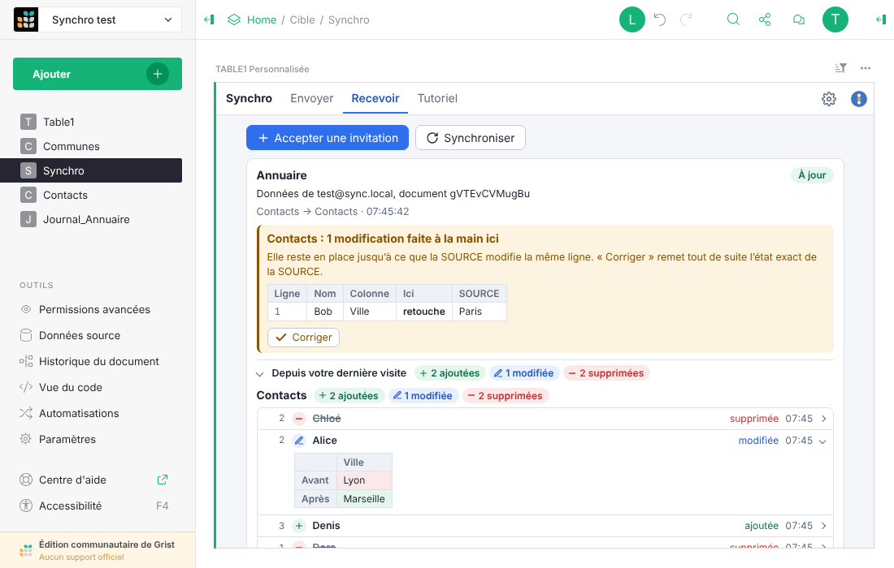
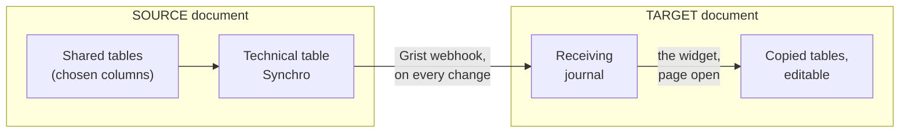
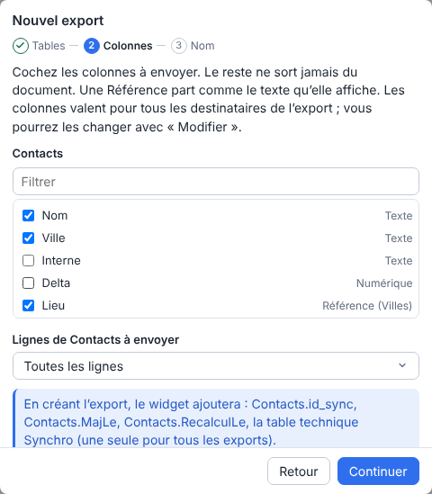
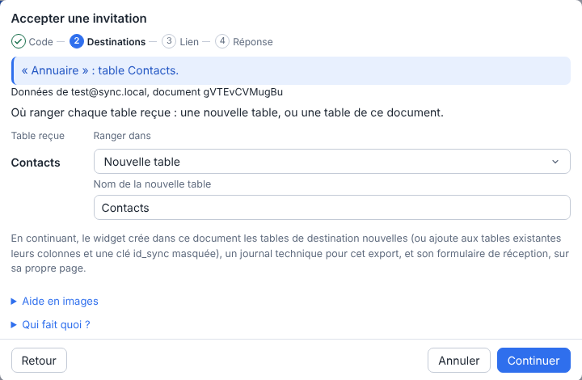
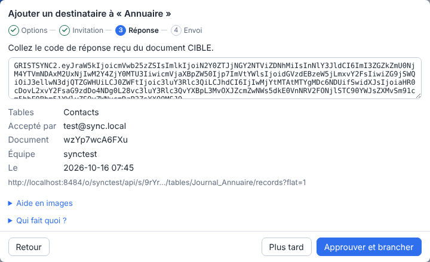
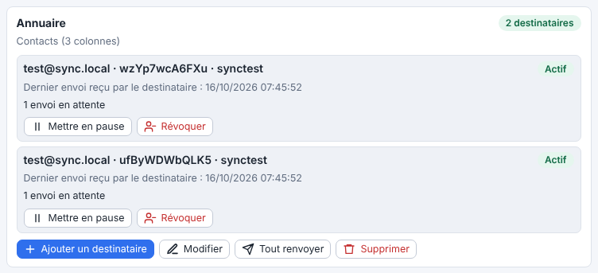
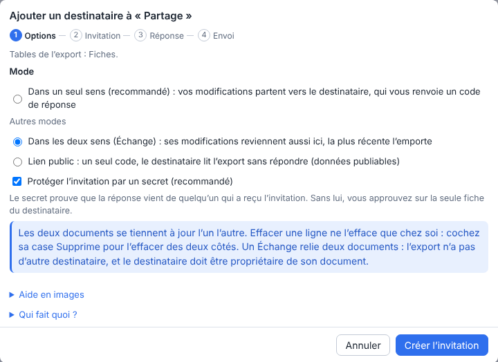

# Grist Sync

**Copy tables from one Grist document into another, and keep them up to date on their own.** 
No server to host, no dependencies, and only the columns you pick leave the document.

[Français](README.md) · **English**

Version 0.5.6 · Grist 1.7.11 or later · GPL-3.0 license · Grist Factory

## What it does

A team keeps a reference table in Grist (contacts, sites, a classification) and other teams need
it in their own documents. Grist Sync sends them a copy they can build on, and updates it whenever
a row is added, changed or deleted in the original.

- **Nothing to host**: Grist itself carries the changes, even when nobody has the document open.
- **You choose what leaves**: the tables, the columns and, optionally, the rows.
- **Each recipient on their own**: add one, pause one, revoke one without touching the others.
- **Both ways if needed**: in Exchange mode, two documents keep each other up to date.

## How it works

The sending document (the **SOURCE**) and the receiving one (the **TARGET**) both have the widget.
In the SOURCE, it prepares the changed rows in a single technical table; a Grist webhook pushes
them right away into the TARGET's journal, through a form the TARGET published for that purpose.
In the TARGET, the widget checks what arrives and copies it into ordinary tables as soon as an
editor opens its page.

## Connect a sync in three steps

Two codes to copy and paste between the two people. They carry no data.

<table>
<tr>
<td width="33%" valign="top">

 <b>1. SOURCE: create the export</b> 
Pick the tables and columns, then add a recipient. The widget gives an
<b>invitation code</b>.
</td>
<td width="33%" valign="top">

 <b>2. TARGET: accept the invitation</b> 
Paste the code, choose where each table goes, copy the link of the published form. The widget
gives a <b>reply code</b>.
</td>
<td width="33%" valign="top">

 <b>3. SOURCE: approve</b> 
Paste the reply, check who accepted, <b>Approve and connect</b>. Existing rows are sent, then
every change.
</td>
</tr>
</table>

The screenshots show the French interface; the widget is also in English (⚙ Settings, Language).
The full walkthrough is in the widget itself (**Tutorial** tab), and every wizard step has its
own picture help. The same walkthrough in French: [`docs/04-tutoriel.md`](docs/04-tutoriel.md).

## Features

- **Exports**: several per document, each with its tables, columns and a row filter; editing an
  export applies to all its recipients.
- **Three modes per recipient**: *one way* (two codes, Grist does the sending even with the
  page closed), *Exchange* (both ways, the most recent change wins) and *public link* (a single
  code, the TARGET reads what the SOURCE publishes).
- **Faithful copy**: additions, changes, deletions, values coming from another table (Reference,
  formula), undo (Ctrl+Z).
- **Destinations of your choice**: new or existing table, matched columns, existing rows linked.
  A table added to the export later is offered in a dialog.
- **Manual edits respected**: a value fixed, a row or a column deleted by hand in the TARGET
  stays that way until the row changes again in the SOURCE, and the card flags it with the detail
  (row, value here, SOURCE value) and a “Fix” button that puts the exact SOURCE state back.
- **Large tables**: no row limit (tested with 21,000), big imports sent in batches, a stuck
  delivery queue is cleared and resent.
- **Clear tracking**: one card per export and per reception, last delivery, errors explained,
  collapsed history of changes since the last visit, with row numbers and values before and
  after.
- **Built-in help**: picture tutorial, “Who does what?”, instructions ready to send by email.
  French and English, light or dark theme.

<table>
<tr>
<td width="50%" valign="top">

 In the SOURCE, each recipient has their own line: pause, resume, revoke.
</td>
<td width="50%" valign="top">

 Three modes per recipient, including two-way Exchange.
</td>
</tr>
</table>

## Installation

**Requirements**: two documents on the same Grist instance, version 1.7.11 or later, in a team
site; an owner of the SOURCE document and an editor of the TARGET document (an owner for
Exchange). **No dependencies**: no library, no build step, no third-party service.

1. Publish this folder as is at an https address (GitHub Pages or any static file hosting). That
   address is the widget's URL.
2. In each document: **Add New**, **Add Page**, **Custom** widget, **Custom URL**, paste the
   address, **Add Widget**.
3. In the right panel, grant **full access**.

The widget works with `grist.numerique.gouv.fr` and `docs.getgrist.com`. For another instance,
add its address to `js/config.js` and to the CSP in `index.html`.

### Document access

- **Full access** (`requiredAccess: 'full'`): the widget reads the structure of the entire
  document (tables and columns, to offer exports and destinations). It creates its technical
  table and tracking columns, writes to the chosen destination tables and, for an owner, manages
  webhooks and the public link's access rules. Read access would allow none of these writes.
- **Network**: apart from the widget API, the widget only talks to the Grist instance, through a
  single function (`gristFetch`, `js/grist.js`) that refuses any other origin and sends no
  cookies. The CSP in `index.html` repeats the same list.
- **Browser**: `localStorage` (keys `gristsync.*`) keeps the language, the theme, the time of the
  last visit per TARGET document and a random browser id. No document data is stored there.

## Security

- Only the ticked columns leave the SOURCE document.
- Each reception has its own write key, tested against its own journal and never shown in full.
  The form link is a write permission: do not share it.
- The TARGET rejects and reports forged rows (“Suspicious arrivals”); a button cuts the link, and
  a new invitation resumes the same reception, with its tables.
- The codes only hold table and column names, the recipient's details and a write address: send
  them only to the person concerned, like a password.

Full analysis (in French): [`SECURITY.md`](SECURITY.md).

## Limits

- Copying into the TARGET happens while an editor has the widget's page open (even collapsed);
  meanwhile, changes wait in the journal.
- The rest of a very large change, and catching up after a pause, are only sent when an owner of
  the SOURCE opens the widget's page.
- A failed delivery blocks the queue of every webhook of the SOURCE document for about
  15 minutes (Grist behaviour); **Unblock the queue** clears it, then resends.
- A table or column renamed in the SOURCE is no longer sent correctly: the export card says so,
  and **Edit** lets you tick the columns again.
- An Exchange is the only recipient of its export. A row larger than 1 MB cannot be sent.

## Documentation

The documentation is in French.

| For | Read |
|---|---|
| Connecting a sync, screenshot by screenshot | [`docs/04-tutoriel.md`](docs/04-tutoriel.md) |
| Security analysis | [`SECURITY.md`](SECURITY.md) |

## License

[GNU GPL v3.0](LICENSE).
