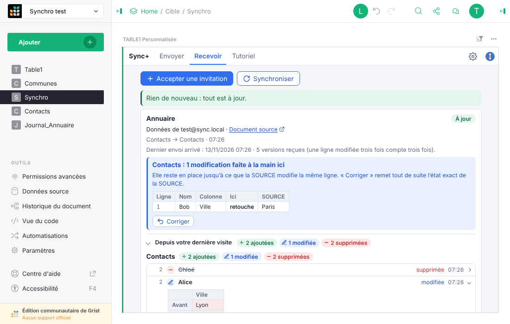
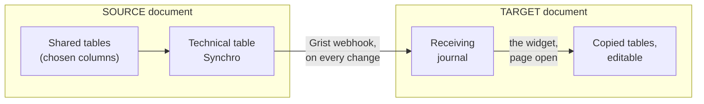
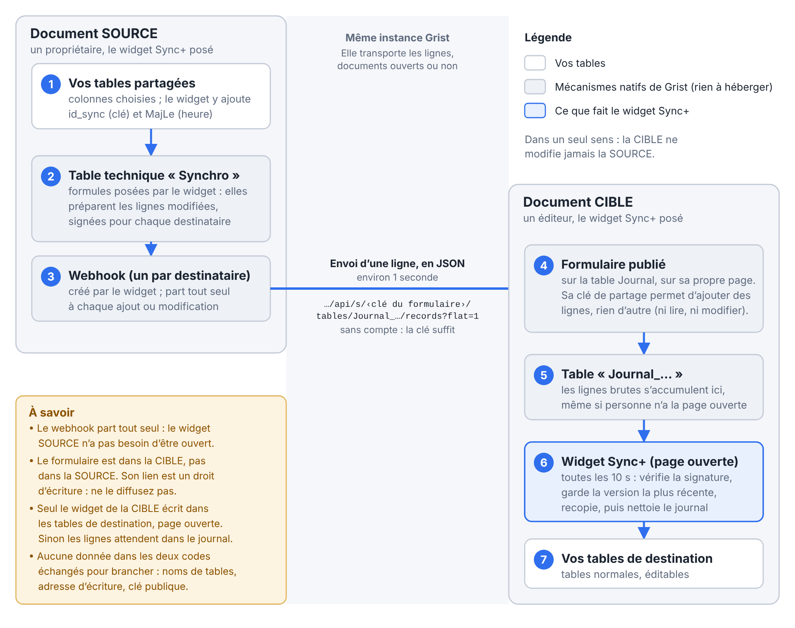
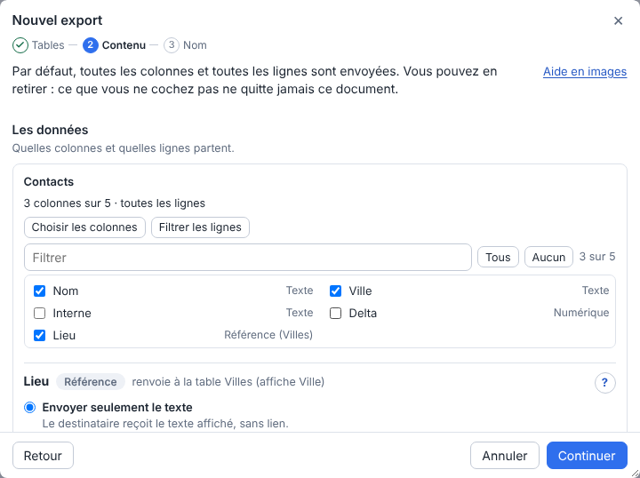
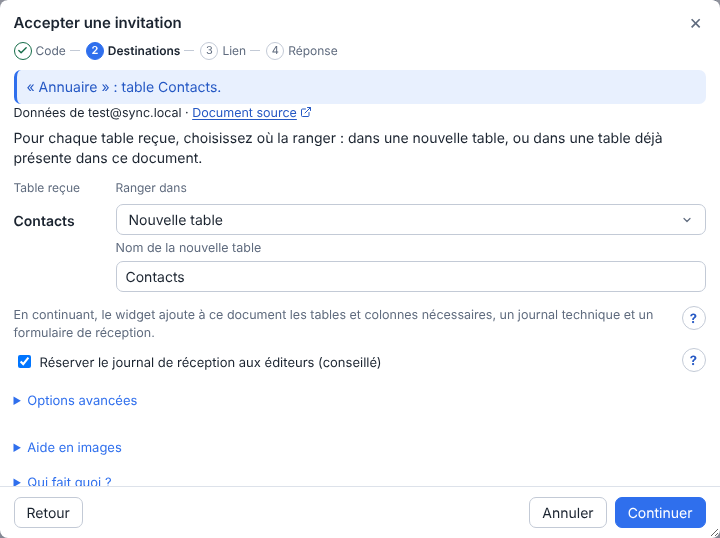
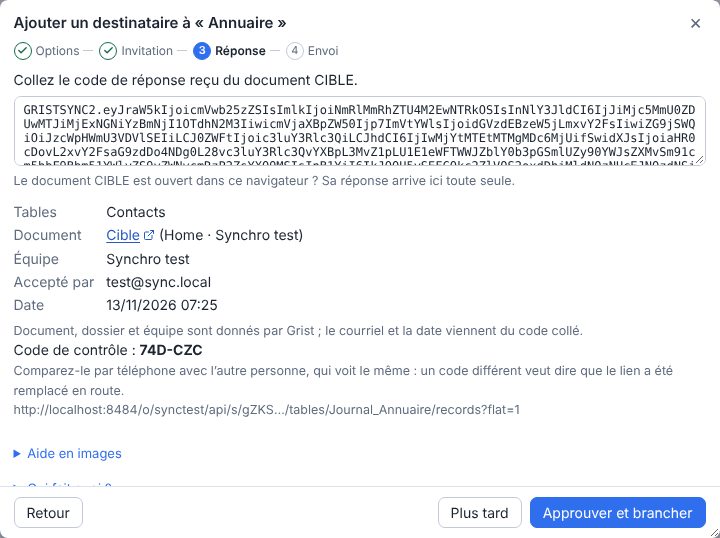
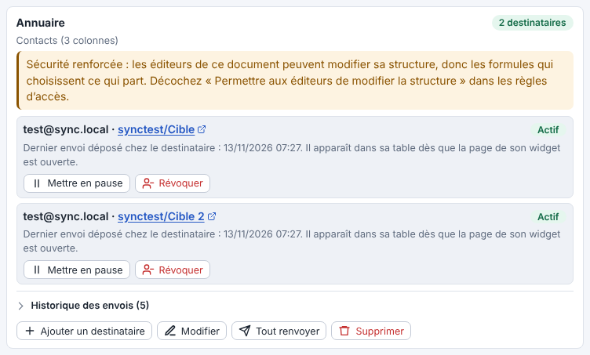
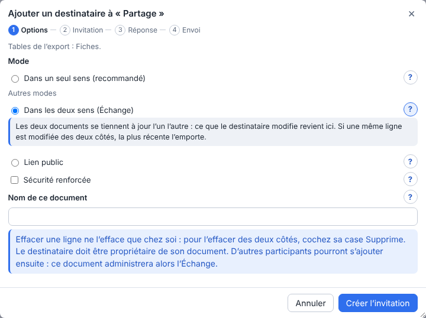

# syncPlus

**Copy tables from one Grist document into another, and keep them up to date on their own.** 
No server to host, no dependencies, and only the columns you pick leave the document.

[Français](README.md) · **English**

Version 0.30.4 · Grist 1.7.11 or later · GPL-3.0 license · Grist Factory

## What it does

A team keeps a reference table in Grist (contacts, sites, a classification) and other teams need
it in their own documents. syncPlus (shown as “Sync+” on screen) sends them a copy they can build
on, and updates it whenever a row is added, changed or deleted in the original.

- **Nothing to host**: Grist itself carries the changes, even when nobody has the document open.
- **You choose what leaves**: the tables, the columns and, optionally, the rows.
- **Each recipient on their own**: add one, pause one, revoke one without touching the others.
- **Both ways if needed**: in Exchange mode, two documents keep each other up to date; with more
  participants, one document runs the Exchange, relays between them and can hold their changes
  for review or refuse them.

## How it works

The sending document (the **SOURCE**) and the receiving one (the **TARGET**) both have the widget.
In the SOURCE, it prepares the changed rows in a single technical table; a Grist webhook pushes
them right away into the TARGET's journal, through a form the TARGET published for that purpose.
In the TARGET, the widget checks what arrives and copies it into ordinary tables as soon as an
editor opens its page.

## Connect a sync in three steps

Two codes to copy and paste between the two people. They carry no data. If you manage both documents and have them open in two tabs of the same browser, the codes pass from one tab to the other in one click (the form link still has to be pasted).

<table>
<tr>
<td width="33%" valign="top">

 <b>1. SOURCE: create the export</b> 
Pick the tables and columns, then add a recipient. The widget gives an
<b>invitation code</b>.
</td>
<td width="33%" valign="top">

 <b>2. TARGET: accept the invitation</b> 
Paste the code, choose where each table goes, copy the link of the published form. The widget
gives a <b>reply code</b>.
</td>
<td width="33%" valign="top">

 <b>3. SOURCE: approve</b> 
Paste the reply, check who accepted, <b>Approve and connect</b>. Existing rows are sent, then
every change.
</td>
</tr>
</table>

The screenshots show the French interface; the widget is also in English (⚙ Settings, Language).
The full walkthrough is in the widget itself (**Tutorial** tab), and every wizard step has its
own picture help. The same walkthrough in French: [`docs/04-tutoriel.md`](docs/04-tutoriel.md).

## Features

- **Exports**: several per document, each with its tables, columns and a row filter (conditions on
  any column type, References included, with the number of rows that will be sent); editing an
  export applies to all its recipients.
- **Three modes per recipient**: *one way* (two codes, Grist does the sending even with the
  page closed), *Exchange* (both ways, the most recent change wins) and *public link* (a single
  code, the TARGET reads what the SOURCE publishes).
- **Faithful copy**: additions, changes, deletions, values coming from another table (Reference,
  formula), undo (Ctrl+Z).
- **Choice lists and formats**: a Choice column arrives with its list and colours, a choice added
  later in the SOURCE is added here; number, date and currency formats are kept. A column the
  TARGET chose is never changed. With a row filter the list is not sent: each recipient only gets the
  values of the rows sent.
- **Attachments**: a ticked column arrives as a real Attachments column; each file is sent once
  per recipient, while the SOURCE page is open, and stored only once. In an Exchange, files travel
  both ways: a row waits for the other document's files before being copied, and a received file
  is not sent back.
- **Links between tables**: each Reference or Reference list column of the export sits in the card
  of its table (Content step): “Send the text only” or “Keep the link”, each choice saying what it
  does. Keeping the link of a table that is not in the export adds it, with a choice: only the
  column it shows (the default), the whole table, or the columns you tick; on the receiving side the column becomes a real Reference (or Reference list) to the
  received table, showing the same column. A column that already holds text there stays text until
  an owner clicks “Rebuild the references”.
- **Column elements**: headers, colors, currency and simple conditional formatting rules
  (“Column formatting” box), column and table descriptions (separate boxes) can travel
  with the export; each box, unticked by default, says how many columns are concerned (Content step,
  “Sent along with the data” section, all boxes visible). The order of the columns and the ones the table's page hides
  have their own box (0.26), also unticked by default: the receiver applies them once to the columns the widget
  created, then on request. A rule is never copied as it is: it is read, then
  rewritten with the receiver's columns. The card flags a different document language (it decides
  how numbers are written) and an owner can set the document with one click. The “Take again from
  the SOURCE” button puts back, element by element, what was retouched on the receiving side.
- **Column formulas** (0.17): a separate box, unticked by default, after a message reminding that a
  formula is Python that Grist runs. Nothing is applied by itself on the receiving side: an owner reads
  them one by one in “Take again from the SOURCE” (those that name a system module or a missing column
  or table are refused outright), then applies them to the columns created by the widget. A data column
  whose trigger formula only applies to new rows (its default value) is sent too, without changing any
  received value. See `SECURITY.md` before offering the box on an instance without a sandbox.
- **Notes out of readers' sight** (0.18): a reader of the document, public link included, sees the columns'
  metadata. The widget's notes (recipients' e-mail and documents, private key of a pending invitation, journal
  secret, signing key) are therefore kept in the options of the hidden columns, which Grist blanks for anyone who
  cannot read them, no longer in their description; the `id_sync` column of received tables is hidden from readers
  by an access rule. An older document is moved the next time an owner or an editor opens it. See `SECURITY.md`,
  “What a reader or the public link sees”.
- **Destinations of your choice**: new or existing table, matched columns, existing rows linked. A table that already has rows is not touched before a preview (rows added, attached, values replaced) that you accept on the card, and a column type that does not suit is flagged.
  A table added to the export later is offered in a dialog.
- **Columns added in the SOURCE**: a column added later to a table of the export is not sent by itself;
  the export's card says so, with “Send these columns” or “Do not send them”. A column that was renamed or
  changed type is named there. A box on the export (unticked by default) sends them by itself.
- **Manual edits respected**: a value fixed, a row or a column deleted by hand in the TARGET
  stays that way until the row changes again in the SOURCE, and the card flags it about ten
  seconds later, with the detail (row, value here, SOURCE value) and a “Fix” button that puts the
  exact SOURCE state back.
- **Columns added by the SOURCE**: a new reception asks for your agreement (the card offers the columns with their
  detail, one click creates and fills them; an "automatic" setting is in the options).
- **Reception options** (not for Exchange): *archive* (a row deleted in the SOURCE stays here,
  ticked “Deleted at the source”) and *read-only* (only owners write in the received tables).
- **Readable windows**: an option fits on one line and its explanation is behind a small “?”;
  Cancel, the cross or Esc closes a window, and the widget asks whether to save or discard when
  something changed.
- **Large tables**: no row limit (tested with 21,000), big imports sent in batches, a stuck
  delivery queue is cleared and resent.
- **Long sends announced and followed**: before a full send, what it will cost (rows, size,
  batches, time); while it runs, progress on the card (rows, batches, time left, budget pause and
  resume time); on the TARGET side, the last delivery that arrived, those waiting to be copied, and
  a status to copy for the person who sends.
- **Clear tracking**: one card per export and per reception, last delivery, errors explained,
  collapsed history of changes since the last visit, with row numbers, values before and after,
  and columns added to the export.
- **Copyable diagnostic** (Settings): version, state of sends and receptions, recent errors,
  with no table data, address or code; and a **send history** on each export (resends, catch-ups,
  pauses, recipients). A **Clear the history** button (export on the SOURCE side, reception on the
  TARGET side) resets it, after confirmation.
- **Older shares** (0.21): a share connected before the signing keys (the Alpha) keeps working, nothing
  is compulsory; “Strengthen security” protects it like the new ones, person by person, and a
  “What's new” window offers it once per version.
- **Built-in help**: picture tutorial, “Who does what?”, instructions ready to send by email.
  French and English, light or dark theme.

<table>
<tr>
<td width="50%" valign="top">

 In the SOURCE, each recipient has their own line: pause, resume, revoke.
</td>
<td width="50%" valign="top">

 Three modes per recipient, including two-way Exchange.
</td>
</tr>
</table>

## Installation

**Requirements**: two documents on the same Grist instance, version 1.7.11 or later, in a team
site; an owner of the SOURCE document and an editor of the TARGET document (an owner for
Exchange). **No dependencies**: no library, no build step, no third-party service.

**Instance webhooks**: Grist only sends a webhook to addresses the instance administrator allows.
On `grist.numerique.gouv.fr` there is nothing to do: webhooks there are limited to the instance,
which is all the widget needs (it sends from one document to another on the same instance). On
another instance, if the widget says on connecting that it "does not allow webhooks to its own
address", write to its administrator and ask for the instance's address to be added to the list of
allowed webhook domains (Grist's `ALLOWED_WEBHOOK_DOMAINS` setting).

1. In each document: **Add New**, **Add Page**, **Custom** widget. Pick Sync+ from the
   instance's **gallery** if it is there; otherwise **Custom URL** and the official address,
   `https://grist-factory.github.io/grist-widget-syncPlus/`, never an address received by email.
   Then **Add Widget**.
2. In Grist's right panel, under **Access level**, click **Accept** (or pick **Full document
   access**): the widget reads and writes the document (see below). Without it, the widget stays
   stuck on a message that shows where to set it
   ([screenshots](docs/04-tutoriel.md#0-installer-le-widget-dans-chaque-document), in French).

The widget works with `grist.numerique.gouv.fr` and `docs.getgrist.com`. For another instance, or to
host your own frozen copy (advised in production, see
[`SECURITY.md`](SECURITY.md#chaîne-dapprovisionnement), in French): copy the repository, change
three values (`GRIST_ORIGINS` and `WIDGET_URL` in `js/config.js`, the security policy in
`index.html`), and publish the files at an https address. The illustrated step-by-step guide, with
the instance gallery and the webhook setting:
[**Hosting your own copy**](docs/08-self-hosting.en.md).

### Document access

- **Full access** (`requiredAccess: 'full'`): the widget reads the structure of the entire
  document (tables and columns, to offer exports and destinations). It creates its technical
  table and tracking columns, writes to the chosen destination tables and, for an owner, manages
  webhooks and the access rules it sets (technical table reserved to owners, journals to
  editors, public link). Read access would allow none of these writes,
  listed in full in [`SECURITY.md`](SECURITY.md#ce-que-le-widget-écrit-et-garde).
  It therefore changes the structure of the document, not only its data: what it creates, modifies,
  renames or deletes, and the user action that triggers it (a deletion is always confirmed), is
  detailed (in French) in [`SECURITY.md`](SECURITY.md#ce-que-le-widget-écrit-et-garde). Outside
  its own tables and columns, it renames and deletes nothing on its own.
- **Network**: apart from the widget API, the widget only talks to the Grist instance, through a
  single function (`gristFetch`, `js/grist.js`) that refuses any other origin and sends no
  cookies. The CSP in `index.html` repeats the same list.
- **Browser**: `localStorage` (keys `gristsync.*`) keeps the language, the theme, the time of the
  last visit per TARGET document and a random browser id. No document data is stored there.

## Security

- Only the ticked columns leave the SOURCE document.
- Each reception has its own write key, tested against its own journal and never shown in full.
  The form link is a write permission: do not share it.
- The TARGET rejects and reports forged rows (“Suspicious arrivals”); a button cuts the link, and
  a new invitation resumes the same reception, with its tables.
- The receiving document is checked with Grist (name, workspace, team) at approval, then every
  hour; a six-character control code can be compared over the phone.
- Sends are signed, with a key specific to each recipient that both documents derive from their
  codes without ever sending it: a reception's write key alone cannot get anything copied, and a
  recipient cannot sign for another one. The TARGET is passive: deletions made in the SOURCE are applied as they are (the Archive option keeps the rows), and the SOURCE is warned when many rows disappear.
- The technical table is reserved to the SOURCE's owners, the journals to the TARGET's editors
  (access rules set by the widget).
- The codes only hold table and column names, the recipient's details, a write address, a secret
  and a public key: send them only to the person concerned, like a password; an invitation is
  valid for 7 days.
- An **Enhanced security** box, when inviting, makes comparing the code mandatory and
  forbids the public link for that export.

Full analysis (in French): [`SECURITY.md`](SECURITY.md).

## Limits

- Copying into the TARGET happens while an editor has the widget's page open (even collapsed);
  meanwhile, changes wait in the journal.
- The rest of a very large change, catching up after a pause and the content of attachments
  (25 MB per file at most) are only sent when an owner of the SOURCE opens the widget's page.
- A failed delivery blocks the queue of every webhook of the SOURCE document for about
  15 minutes (Grist behaviour); **Unblock the queue** clears it, then resends.
- A table or column renamed in the SOURCE is no longer sent correctly: the export card says so,
  and **Edit** lets you tick the columns again.
- An export in Exchange only has Exchange participants. A row larger than 1 MB cannot be sent.
- A **Binary (Blob)** column is not sent: Grist does not write bytes into a column through its APIs, so another
  document could not receive them faithfully. The wizard says so at the Content step.

## Documentation

The documentation is in French.

| For | Read |
|---|---|
| Connecting a sync, screenshot by screenshot | [`docs/04-tutoriel.md`](docs/04-tutoriel.md) |
| Hosting your own copy, for a private instance or a frozen version | [`docs/08-self-hosting.en.md`](docs/08-self-hosting.en.md) |
| Security analysis | [`SECURITY.md`](SECURITY.md) |

## License

[GNU GPL v3.0](LICENSE).
