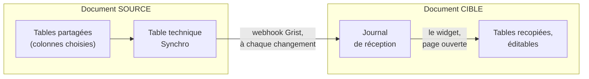

# Synchro Grist

**Recopiez des tables d'un document Grist dans un autre, tenues à jour toutes seules.** 
Sans serveur à héberger, sans dépendance, et seules les colonnes que vous choisissez sortent.

**Français** · [English](README.en.md)

Version 0.5.9 · Grist 1.7.11 ou plus récent · licence GPL-3.0 · Grist Factory

## À quoi ça sert

Un service tient une table de référence dans Grist (contacts, établissements, nomenclature) et
d'autres équipes en ont besoin dans leurs propres documents. Synchro Grist leur en envoie une copie
qu'elles peuvent compléter, et la met à jour à chaque ajout, modification ou suppression dans
l'original.

- **Rien à héberger** : c'est Grist qui transporte les changements, même quand personne n'a le
  document ouvert.
- **Vous choisissez ce qui sort** : les tables, les colonnes et, en option, les lignes.
- **Chaque destinataire à part** : on en ajoute, on en met un en pause, on en révoque un sans
  toucher aux autres.
- **Dans les deux sens si besoin** : en mode Échange, deux documents se tiennent à jour l'un
  l'autre.

## Comment ça marche

Le document qui envoie (la **SOURCE**) et celui qui reçoit (la **CIBLE**) ont chacun le widget.
Dans la SOURCE, il prépare les lignes modifiées dans une seule table technique ; un webhook de
Grist les pousse aussitôt dans le journal de la CIBLE, par un formulaire qu'elle a publié pour
cela. Dans la CIBLE, le widget contrôle ce qui arrive et le recopie dans des tables normales dès
qu'un éditeur ouvre sa page.

## Brancher une synchro en trois étapes

Deux codes à copier-coller entre les deux personnes. Ils ne contiennent aucune donnée.

<table>
<tr>
<td width="33%" valign="top">

 <b>1. SOURCE : créer l'export</b> 
Choisir les tables et les colonnes, puis ajouter un destinataire. Le widget donne un
<b>code d'invitation</b>.
</td>
<td width="33%" valign="top">

 <b>2. CIBLE : accepter l'invitation</b> 
Coller le code, choisir où ranger chaque table, copier le lien du formulaire publié. Le widget
donne un <b>code de réponse</b>.
</td>
<td width="33%" valign="top">

 <b>3. SOURCE : approuver</b> 
Coller la réponse, vérifier qui a accepté, <b>Approuver et brancher</b>. Les lignes existantes
partent, puis chaque modification.
</td>
</tr>
</table>

Le pas à pas complet, capture par capture, est dans le [tutoriel](docs/04-tutoriel.md). Il est
aussi dans le widget (onglet **Tutoriel**), et chaque étape des assistants a son aide en images.

## Fonctionnalités

- **Exports** : plusieurs par document, chacun avec ses tables, ses colonnes et un filtre de
  lignes ; une modification de l'export vaut pour tous ses destinataires.
- **Trois modes par destinataire** : *dans un seul sens* (deux codes, l'envoi est fait par Grist même
  page fermée), *Échange* (dans les deux sens, la modification la plus récente l'emporte) et
  *lien public* (un seul code, la CIBLE lit ce que la SOURCE publie).
- **Recopie fidèle** : ajouts, modifications, suppressions, valeurs venues d'une autre table
  (Référence, formule), annulation (Ctrl+Z).
- **Destinations au choix** : table nouvelle ou existante, colonnes mises en correspondance,
  lignes déjà présentes rattachées. Une table ajoutée plus tard à l'export est proposée dans une
  fenêtre.
- **Retouches respectées** : une valeur corrigée, une ligne ou une colonne supprimée à la main
  dans la CIBLE reste ainsi jusqu'au prochain changement de la ligne dans la SOURCE, et la carte la
  signale une dizaine de secondes après, avec le détail (ligne, valeur d'ici, valeur de la SOURCE)
  et un bouton « Corriger » qui remet l'état exact de la SOURCE.
- **Grandes tables** : pas de limite de lignes (testé avec 21 000), gros imports envoyés par
  tranches, file d'envoi bloquée vidée puis renvoyée.
- **Suivi clair** : une carte par export et par réception, dernier envoi, erreurs expliquées,
  historique replié des changements depuis la dernière visite, avec numéro de ligne, valeurs
  avant et après, et colonnes ajoutées à l'export.
- **Aide intégrée** : tutoriel en images, « Qui fait quoi ? », consignes prêtes à envoyer par
  courriel. Français et anglais, thème clair ou sombre.

<table>
<tr>
<td width="50%" valign="top">

 Dans la SOURCE, chaque destinataire a sa ligne : pause, reprise, révocation.
</td>
<td width="50%" valign="top">

 Trois modes par destinataire, dont l'Échange dans les deux sens.
</td>
</tr>
</table>

## Installation

**Prérequis** : deux documents de la même instance Grist, version 1.7.11 ou plus récente, dans un
espace d'équipe ; un propriétaire du document SOURCE, un éditeur du document CIBLE (propriétaire
en Échange). **Aucune dépendance** : ni bibliothèque, ni étape de build, ni service tiers.

1. Publier ce dossier tel quel sur une adresse https (GitHub Pages ou tout hébergement de fichiers
   statiques). Cette adresse est celle du widget.
2. Dans chaque document : **Ajouter**, **Ajouter une page**, vue **Personnalisée**, **URL
   personnalisée**, coller l'adresse, **Ajouter un widget**.
3. Dans le panneau de droite, accepter l'**accès complet**.

Le widget fonctionne avec `grist.numerique.gouv.fr` et `docs.getgrist.com`. Pour une autre
instance, ajouter son adresse dans `js/config.js` et dans la CSP de `index.html`.

### Accès au document

- **Accès complet** (`requiredAccess: 'full'`) : le widget lit la structure de l'ensemble du
  document (tables et colonnes, pour proposer exports et destinations). Il crée sa table technique
  et ses colonnes de suivi, écrit dans les tables de destination choisies et, pour un
  propriétaire, gère les webhooks et les règles d'accès du lien public. Un accès en lecture ne
  permettrait aucune de ces écritures.
- **Réseau** : en dehors de l'API des widgets, le widget ne parle qu'à l'instance Grist, par une
  seule fonction (`gristFetch`, `js/grist.js`) qui refuse toute autre origine et n'envoie aucun
  cookie. La CSP de `index.html` reprend la même liste.
- **Navigateur** : `localStorage` (clés `gristsync.*`) garde la langue, le thème, l'heure de la
  dernière visite par document CIBLE et un identifiant de navigateur tiré au hasard. Aucune donnée
  du document n'y est écrite.

## Sécurité

- Seules les colonnes cochées quittent le document SOURCE.
- Chaque réception a sa propre clé d'écriture, testée sur son journal et jamais affichée en
  entier. Le lien du formulaire est un droit d'écriture : il ne se diffuse pas.
- La CIBLE rejette et signale les lignes forgées (« Arrivées suspectes ») ; un bouton coupe le
  lien, et une nouvelle invitation fait reprendre la même réception, avec ses tables.
- Les codes ne contiennent que des noms de tables et de colonnes, une fiche et une adresse
  d'écriture : ils se transmettent à la seule personne concernée, comme un mot de passe.

L'analyse complète est dans [`SECURITY.md`](SECURITY.md).

## Limites

- La recopie dans la CIBLE se fait quand un éditeur a la page du widget ouverte (même repliée) ;
  entre-temps, les changements attendent dans le journal.
- Le reste d'un très gros changement, et le rattrapage après une pause, ne partent que lorsqu'un
  propriétaire de la SOURCE ouvre la page du widget.
- Un envoi en échec bloque la file de tous les webhooks du document SOURCE pendant environ
  15 minutes (comportement de Grist) ; **Débloquer la file** la vide puis renvoie.
- Une table ou une colonne renommée dans la SOURCE ne part plus correctement : la carte de
  l'export le signale, et **Modifier** permet de cocher de nouveau les colonnes.
- Un Échange est le seul destinataire de son export. Une ligne de plus de 1 Mo ne peut pas partir.

## Documentation

| Pour | Lire |
|---|---|
| Brancher une synchro, capture par capture | [`docs/04-tutoriel.md`](docs/04-tutoriel.md) |
| Analyse de sécurité | [`SECURITY.md`](SECURITY.md) |

## Licence

[GNU GPL v3.0](LICENSE).
