# Tutoriel : brancher une synchro en dix minutes

Deux documents Grist de la même instance, dans un espace d'équipe :

- la **SOURCE**, qui a les tables à partager (ici `Contacts`, puis `Villes`) ;
- la **CIBLE**, qui en reçoit une copie tenue à jour (ici `Contacts`, et `Communes`, un
  référentiel qui existait déjà).

Il faut un **propriétaire** de la SOURCE et un **éditeur** de la CIBLE, et Grist 1.7.11 ou plus
récent (le widget le vérifie au branchement).

La SOURCE organise ses envois en **exports** : un export a un nom, des tables et, pour chacune, les
colonnes qui partent. On y ajoute ensuite les personnes qui le reçoivent, une à une, et on peut en
révoquer une seule sans toucher aux autres. Trois modes par personne :

- **avec réponse** (recommandé) : ils échangent deux codes ; Grist pousse chaque modification vers
  la CIBLE, même quand personne n'a la page ouverte ;
- **Échange** : la même chose dans les deux sens, chaque document tient l'autre à jour (voir
  [plus bas](#échange-dans-les-deux-sens)) ;
- **lien public** : un seul code ; la SOURCE devient lisible par lien public, mais uniquement les
  exports publics (voir [plus bas](#mode-lien-public)).

Aucune donnée ne passe par les codes : seulement des noms de tables et de colonnes, une fiche, et
une adresse d'écriture. Ils se transmettent donc à la seule personne concernée, comme un mot de
passe.

Les captures montrent l'écran de la version du dépôt. Le même tutoriel, avec les captures, est dans le widget (onglet
**Tutoriel**) ; chaque étape des assistants en montre le morceau utile (**Aide en images**) et
**Qui fait quoi ?** dit ce que fait chaque document. Aux étapes où un code change de main,
**Copier avec les consignes** copie le code et les étapes de l'autre document, prêts pour un
courriel.

## 0. Installer le widget (dans chaque document)

**Ajouter**, **Ajouter une page**, vue **Personnalisée** (n'importe quelle table), **Ajouter une
page** ; **URL personnalisée**, coller l'adresse du widget, **Ajouter un widget** (Grist peut
demander de confirmer) ; dans le panneau de droite, accepter l'**accès complet**. Renommer la
page, par exemple « Synchro ». Les tables techniques n'ont pas de page : elles sont dans « Données
source ».

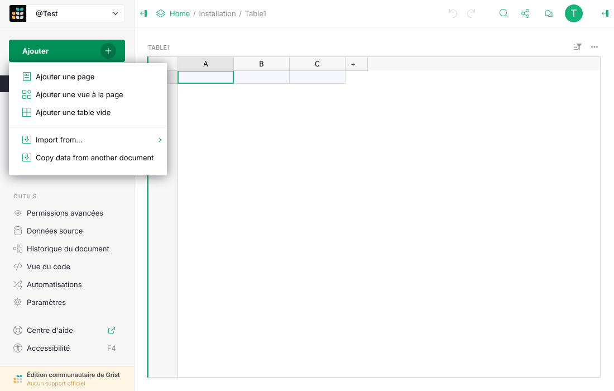

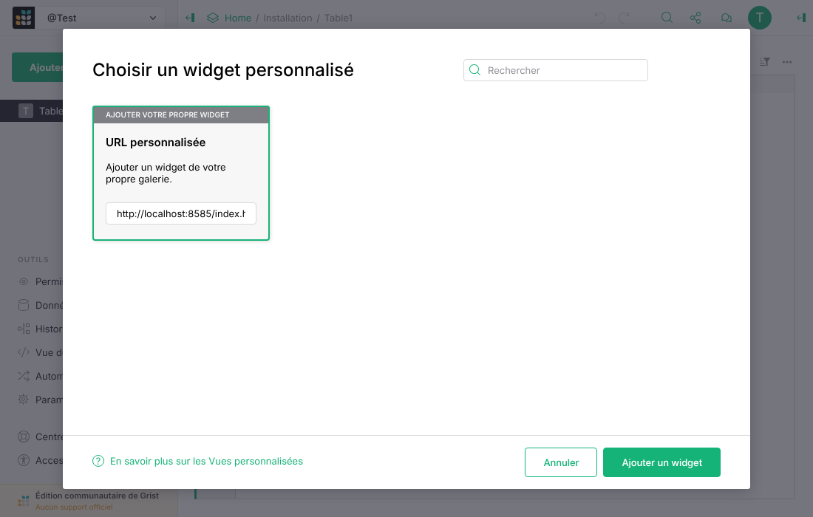
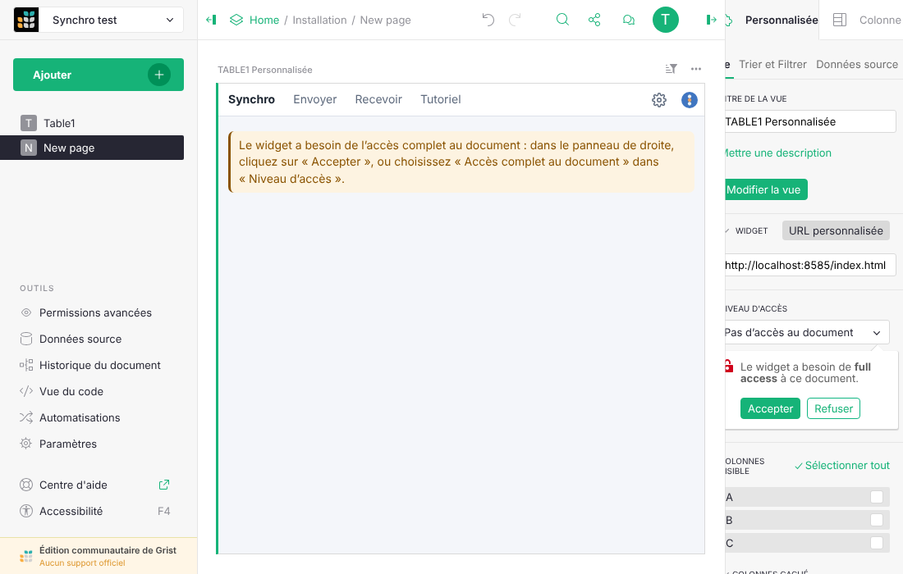

Au premier lancement, le widget demande le rôle du document. Ensuite il ouvre directement
**Recevoir** dans un document qui reçoit, **Envoyer** dans un document qui envoie.

## Côté SOURCE : créer un export

### 1. Choisir les tables

**Envoyer**, **Nouvel export**, cocher les tables de l'export.

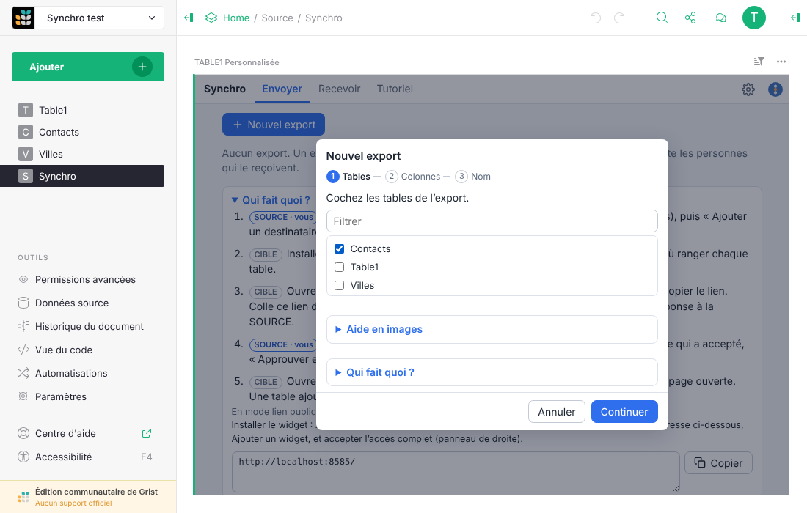

### 2. Choisir les colonnes

Cocher les colonnes qui partent (toutes par défaut). Le reste ne sort jamais du document. Une
Référence part comme le texte qu'elle affiche ; les pièces jointes ne partent pas. Les colonnes
valent pour toutes les personnes qui reçoivent l'export. En option, un **filtre de lignes** par
table : seules partent les lignes où une colonne vaut un texte donné ; une ligne qui en sort est
effacée chez les destinataires.

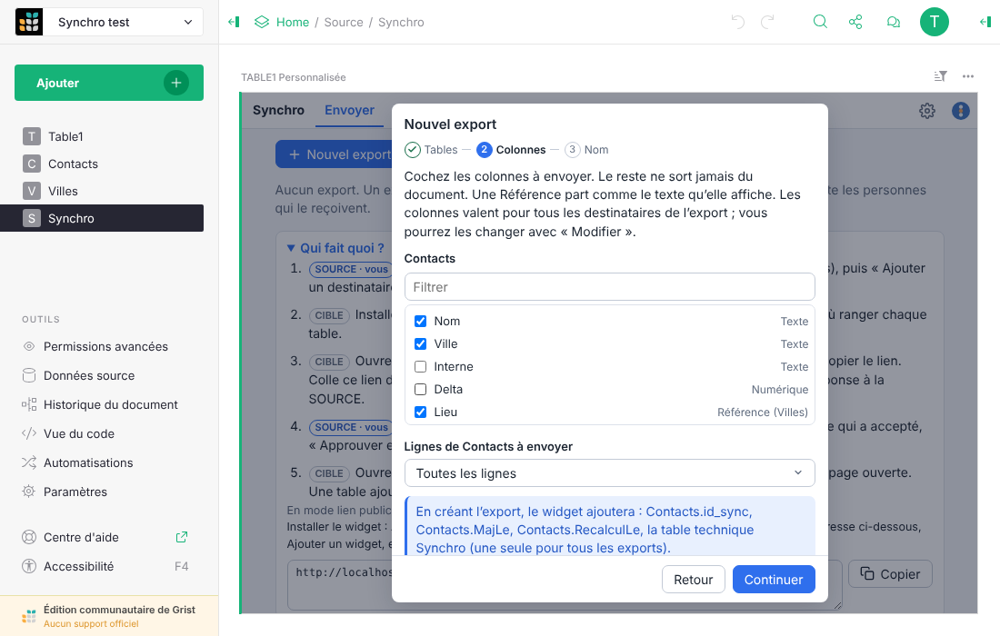

Le widget dit ce qu'il ajoutera, et ne l'ajoute qu'à la dernière étape :

- `id_sync` dans chaque table : identifiant stable de chaque ligne (les `id` de Grist sont
  réutilisés) ;
- `MajLe` dans chaque table : date du dernier changement d'une valeur envoyée (y compris le texte
  affiché par une Référence), pour remettre les versions dans l'ordre et repérer ce qui doit
  partir ;
- la table technique `Synchro`, une seule pour tout le document, quel que soit le nombre d'exports
  et de tables : pour chaque table d'un export, une ligne liste les `id_sync` existants (les vraies
  suppressions partent ainsi), une autre porte les lignes qui viennent d'être modifiées.

Une colonne `Supprime` (case à cocher) déjà présente dans une table est prise en compte : une ligne
cochée est retirée de la CIBLE sans être effacée de la SOURCE. Le widget ne l'ajoute pas.

### 3. Nommer l'export

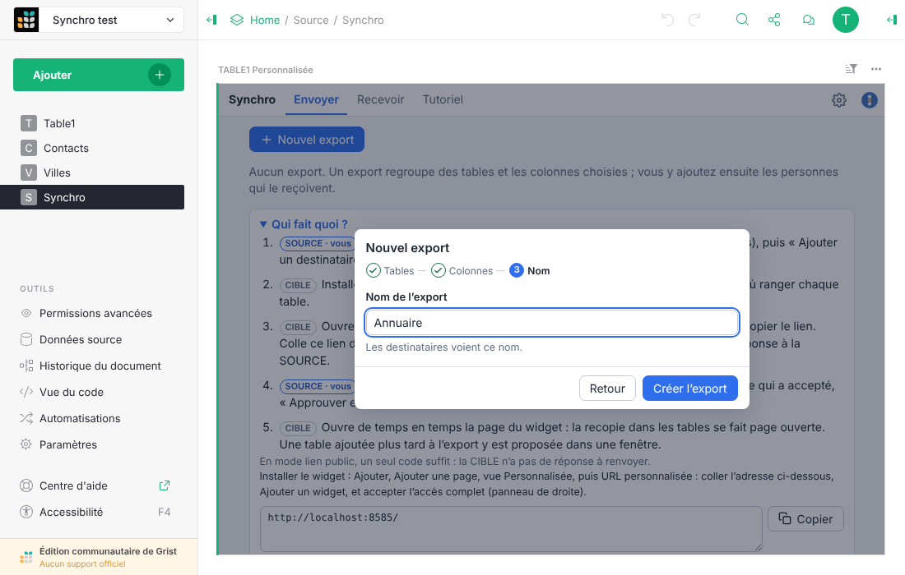

Les destinataires voient ce nom. **Créer l'export**, puis **Ajouter un destinataire**.

### 4. Ajouter un destinataire

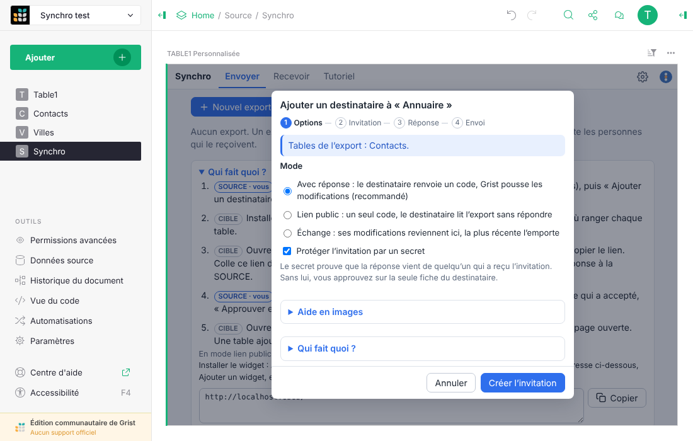

Choisir le mode. Le **secret** (coché par défaut) garantit que la réponse vient de quelqu'un qui a
reçu l'invitation ; sans secret, l'approbation repose sur la seule fiche du destinataire, que vous
vérifiez à l'étape 10.

### 5. Copier l'invitation

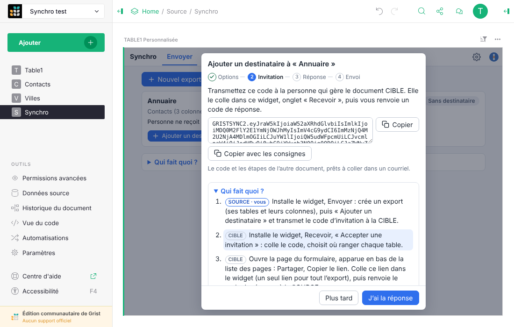

Envoyer ce code à la personne de la CIBLE. **Plus tard** ferme l'assistant : l'invitation reste en
attente sur la carte de l'export.

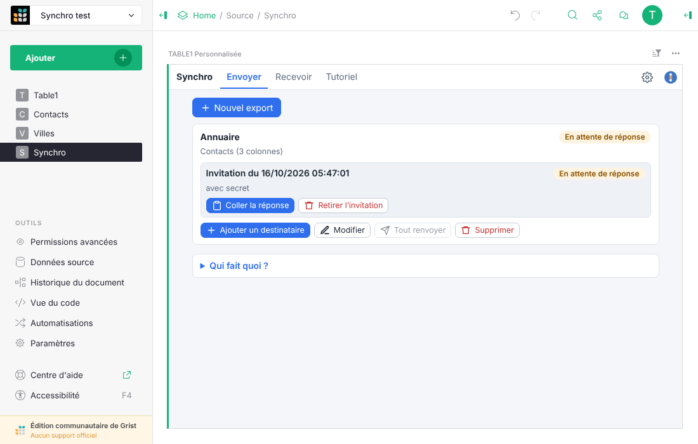

## Côté CIBLE : accepter

### 6. Coller le code

**Recevoir**, **Accepter une invitation**, coller le code.

### 7. Choisir les destinations

Pour chaque table de l'export, ouvrir la liste et choisir **Nouvelle table** (nom modifiable) ou
une table du document. Pour une table existante, le widget demande où va chaque colonne et par
quelle colonne rattacher les lignes déjà là (voir [Une table ajoutée à l'export](#une-table-ajoutée-à-lexport)).

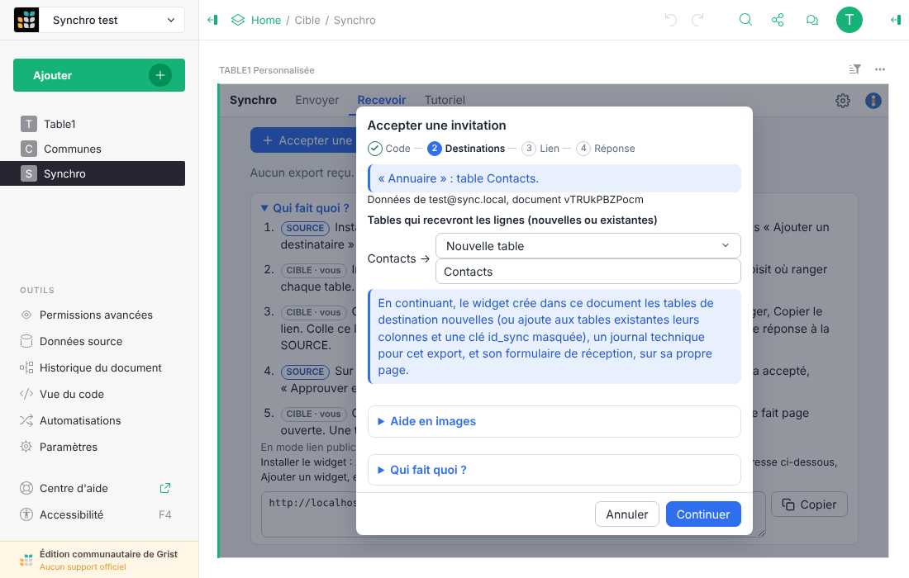

Le widget crée un journal pour l'export, `Journal_<export>` (dans « Données source »), et publie
son formulaire de réception sur sa propre page, `Journal_<export>`, en bas de la liste des pages.

### 8. Copier le lien du formulaire

L'assistant montre où cliquer : ouvrir la page du formulaire, en bas de la liste des pages, puis dans sa
carte **Partager** et **Copier le lien** ; coller ce lien dans le widget, **Tester le lien**. Le
widget vérifie que le lien écrit bien dans le journal de cette réception (le lien d'un autre
formulaire ou d'un autre document est refusé). Un seul lien sert pour toutes
les tables de l'export, et pour celles qui s'y ajouteront.

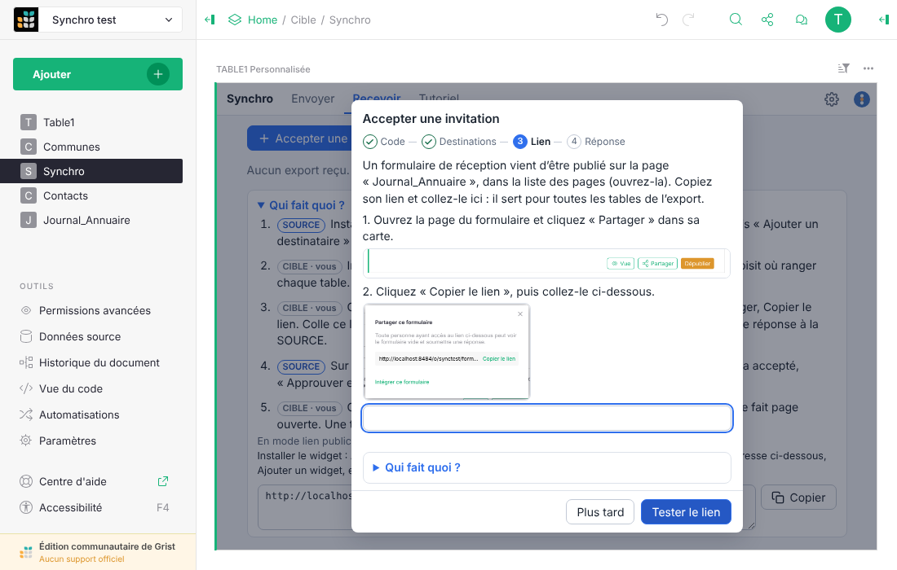

Ce lien est un **droit d'écriture** dans votre journal : ne le diffusez pas ailleurs. Chaque
réception a le sien, sur sa page.

### 9. Renvoyer la réponse

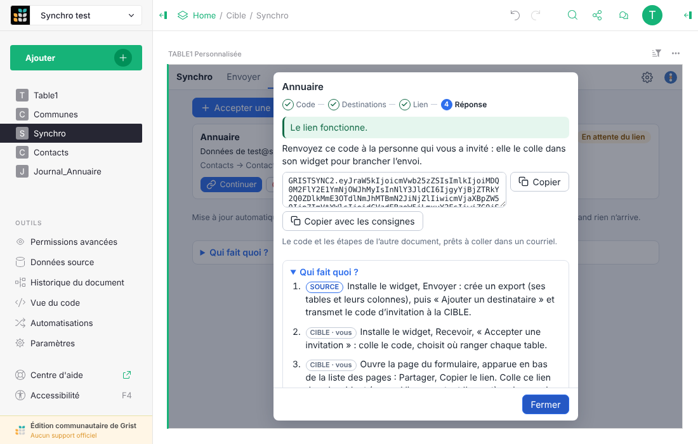

Copier le code de réponse et le renvoyer à la SOURCE. Il contient l'adresse d'écriture et votre
fiche (e-mail, document, équipe).

## Côté SOURCE : approuver

### 10. Coller la réponse

Sur la carte de l'export, ligne de l'invitation, **Coller la réponse**. Le widget montre qui a
accepté et quelles tables partiront : vérifier que c'est la bonne personne, puis **Approuver et
brancher**. Grist reçoit un webhook filtré sur cet export : la personne ne reçoit que ses lignes.

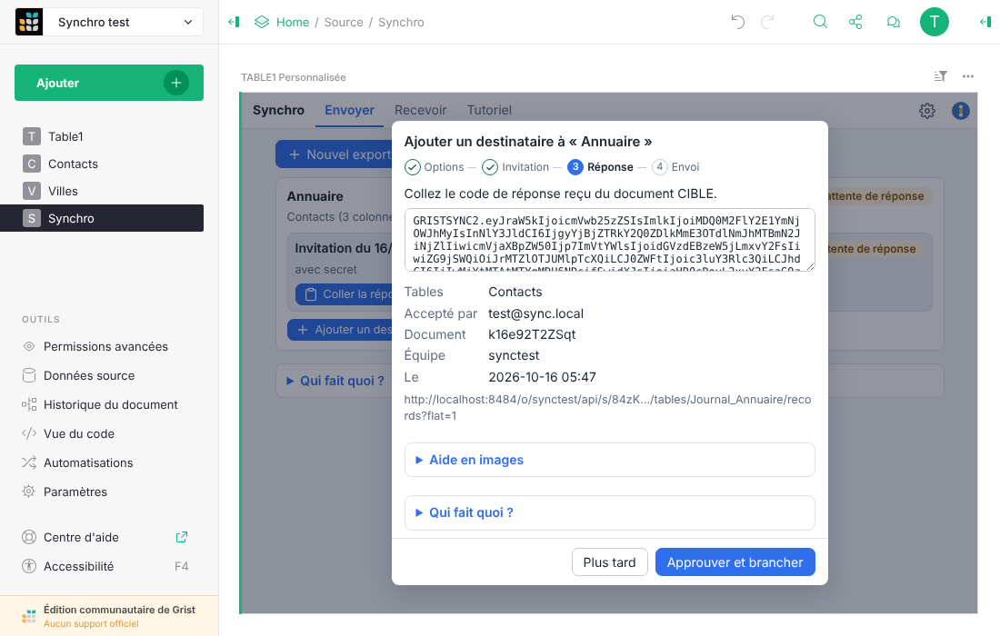

### 11. Envoyer les lignes existantes

Le branchement n'envoie que les changements à venir. **Envoyer** pousse les lignes déjà là.

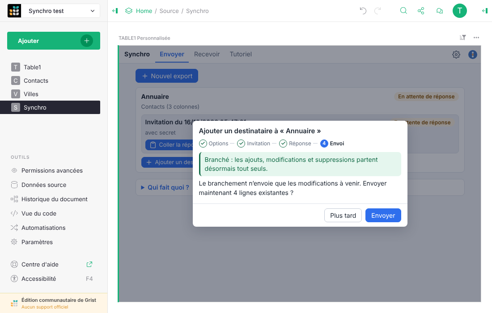

## Gérer un export

La carte de l'export liste ses tables et ses destinataires, chacun avec son dernier envoi reçu.

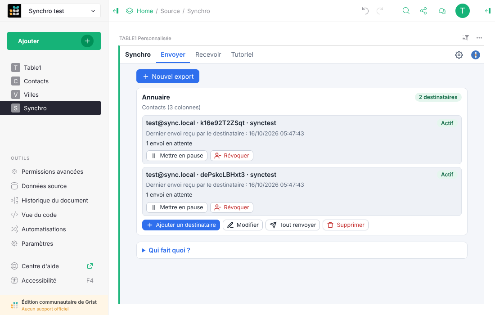

Pour l'export :

- **Ajouter un destinataire** : une invitation de plus, sans refaire l'export ;
- **Modifier** : ajouter ou retirer des tables, changer les colonnes ou le nom. Cela vaut pour tous
  les destinataires ; les lignes concernées repartent, une table ajoutée leur est proposée (voir
  plus bas) ;
- **Tout renvoyer** ;
- **Supprimer** : coupe tous ses destinataires ; la table `Synchro` disparaît avec le dernier
  export. Les colonnes `id_sync` et `MajLe` restent dans vos tables.

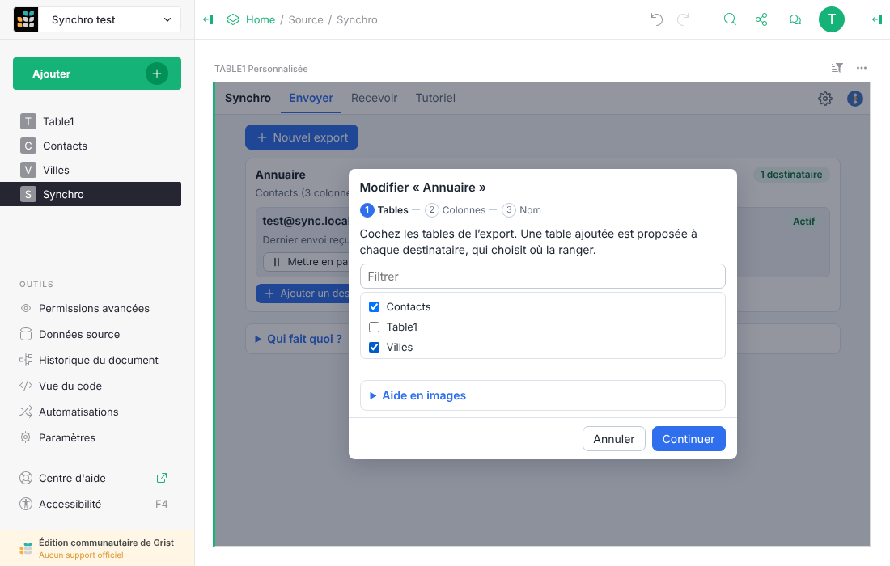

Pour une personne :

- **Mettre en pause**, puis **Reprendre** : Grist n'envoie rien pendant une pause. À la reprise, le
  widget propose de **rattraper** (recommandé) : il renvoie seulement les lignes modifiées ou
  ajoutées pendant la pause, et la liste des clés pour les suppressions ; ou de reprendre sans
  rattraper ;
- **Débloquer la file**, quand un envoi échoue (Grist bloque alors toute la file du document
  environ 15 minutes) : le widget vide la file, puis renvoie seul ce qu'elle portait (gardez la
  page ouverte) ;
- **Révoquer** : ses envois s'arrêtent, les autres destinataires continuent.

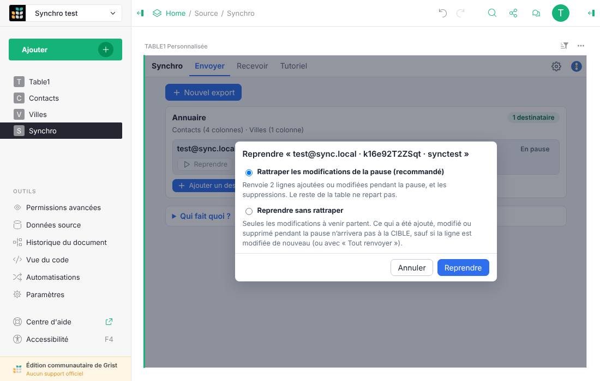

Un renvoi (après l'ajout d'un destinataire, une reprise, **Tout renvoyer**) part vers tous les
destinataires de l'export. Chez ceux qui avaient déjà ces lignes, il est sans effet : une ligne que
la SOURCE n'a pas changée garde ses retouches.

## Au quotidien, côté CIBLE

Chaque ajout, modification ou suppression dans la SOURCE arrive dans le journal en une seconde
environ, même si personne n'a le widget ouvert. La **recopie** dans les tables de destination se
fait quand un éditeur ouvre la page du widget (même replié), puis toutes les 10 secondes tant
qu'elle reste ouverte.

La carte montre le propriétaire des données, chaque table reçue avec sa destination et son dernier
passage, et l'historique : depuis votre dernière visite, par table, le nombre de lignes ajoutées,
modifiées et supprimées, puis les lignes elles-mêmes (20 au plus par table), nommées par la colonne
de votre choix. Une retouche faite à la main dans la CIBLE reste en place jusqu'à la prochaine
modification de la même ligne dans la SOURCE. Une table ou une colonne de destination peut être
renommée : la recopie suit. **Arrêter la réception** efface le journal, son formulaire et sa page,
et garde les tables de destination.

### Une table ajoutée à l'export

Quand la SOURCE ajoute une table à l'export, ses lignes arrivent dans le même journal, et le widget
demande où la ranger, dans une fenêtre qui s'ouvre seule :

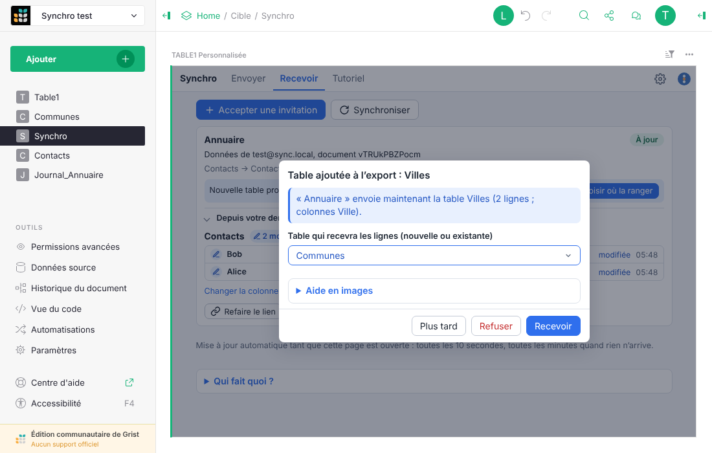

- **Recevoir** dans une nouvelle table, ou dans une table du document : le widget demande alors où
  va chaque colonne envoyée (la même, une autre, ou une nouvelle) et par quelle colonne **rattacher
  les lignes déjà là** : une ligne déjà présente dont cette colonne a la même valeur qu'une ligne
  reçue est mise à jour au lieu d'être doublée. Ici, `Ville` va dans `Commune`, et Lyon, déjà là
  avec une note, est rattachée ;
- **Refuser** : ses lignes sont effacées du journal à mesure qu'elles arrivent ;
- **Plus tard** : la table reste proposée sur la carte, ses lignes attendent dans le journal.

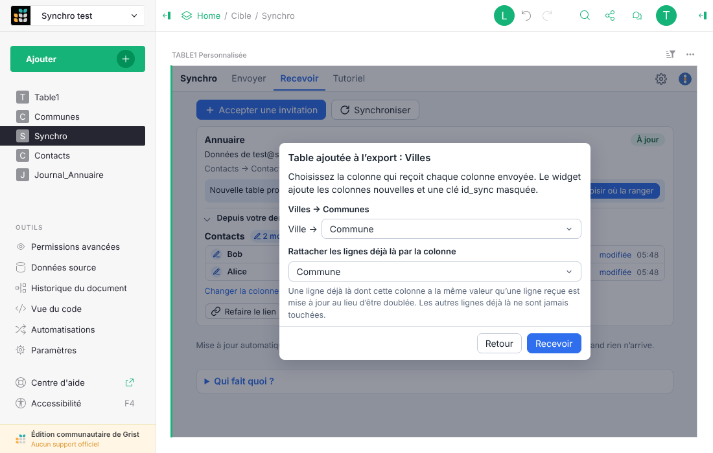

### Gros changements, valeurs venues d'une autre table

Un envoi de Grist est limité en taille : un changement de plus de 2 000 lignes environ, fait d'un
seul coup (un import, un remplacement), ne part qu'en partie. Grist note dans la table `Synchro`
depuis quand des lignes manquent, et le widget SOURCE envoie le reste par tranches, **seul**, dès
qu'un propriétaire ouvre sa page (même repliée). En attendant, la carte de la CIBLE dit combien de
lignes ne sont pas encore arrivées :

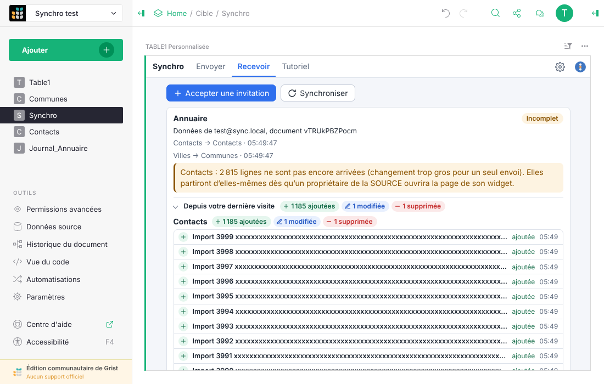

Une valeur qui change à cause d'une autre table (le nom d'une ville renommée, affiché par une
Référence, ou une formule) repart seule, sans toucher la ligne.

Une **grande table** part comme une petite : la liste de ses clés tient en 256 empreintes, dont
seules celles qui changent partent, et le widget envoie la liste complète par morceaux quand il
le faut (vérifié avec 21 000 lignes). Si des envois en attente dépassent ensemble la taille
permise par Grist, 1 Mo (la CIBLE a refusé un moment), le widget SOURCE vide la file et renvoie
tout, seul, dès qu'un propriétaire ouvre sa page.

### Arrivées suspectes, couper le lien

Si des lignes arrivent dans le journal sans pouvoir venir de la SOURCE (autre export, contenu
illisible), ou en nombre anormal, la carte affiche **Arrivées suspectes** : rien n'a été recopié.
Si vous ne l'expliquez pas, **Couper le lien** : l'ancien lien n'écrit plus rien. La SOURCE
révoque alors l'ancien destinataire et vous envoie une nouvelle invitation ; acceptez-la ici, la
même réception reprend avec ses tables (le widget montre d'abord d'où vient l'invitation).

Une réception créée avant la version 0.5 peut avoir son formulaire sur la même page qu'un autre :
la carte le signale (**Lien commun à d'autres formulaires**), et **Couper le lien** l'en sépare.

## Échange, dans les deux sens

Deux documents se tiennent à jour l'un l'autre : une modification faite d'un côté passe de
l'autre, sans revenir ; quand la même ligne change des deux côtés, **la plus récente l'emporte**.
Il faut un **propriétaire** de chaque côté (chacun envoie par son propre webhook).

1. SOURCE : créer l'export, puis **Ajouter un destinataire** (le premier de l'export), mode
   **Échange**. Le widget publie un formulaire de retour sur sa propre page, en bas de la liste des pages :
   copier son lien et le coller, il part dans l'invitation (qui devient un droit d'écriture).

   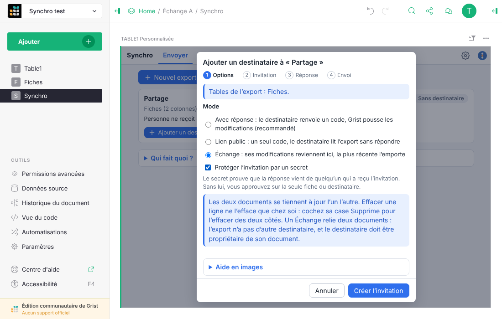

2. CIBLE : accepter l'invitation comme d'habitude. La réponse branche les deux sens à la fois.
3. SOURCE : coller la réponse, **Approuver et brancher**, **Envoyer** les lignes existantes.

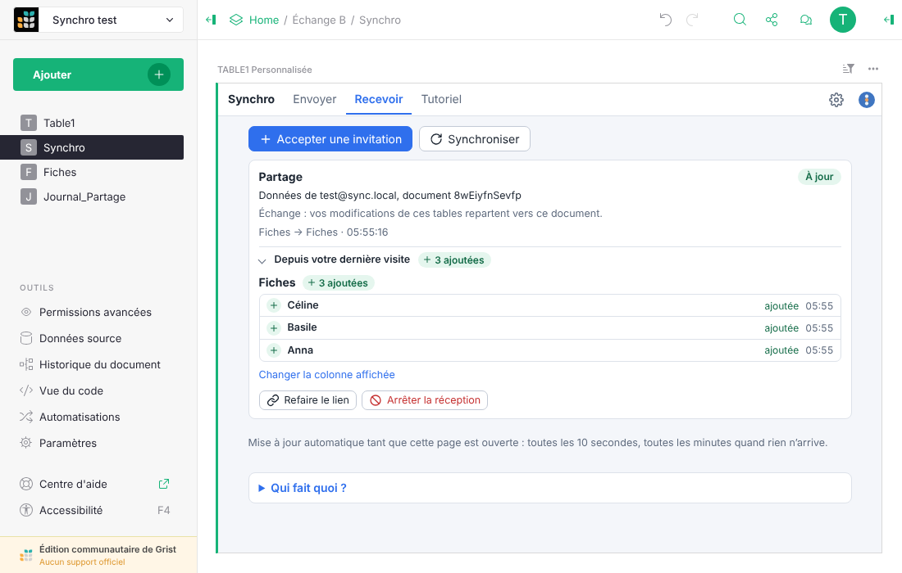

Une case `Supprime` est ajoutée aux tables : cochée d'un côté, la ligne disparaît des deux. Une
ligne déjà présente dans la CIBLE, sans clé, reste à ce document. Arrêter, d'un côté ou de l'autre,
arrête les deux sens ; les tables gardent leurs lignes.

## Mode lien public

À l'étape 4, choisir **Lien public**. Le widget pose des règles d'accès : toute personne qui n'est
que **lectrice** du document, dont le lien public, ne voit plus que les instantanés des exports
publics, dans la table `Synchro`. Ensuite, dans le menu **Partager** du document, régler « Lien
public » sur **Lecture**. La ligne passe de « Lien public à activer » à « Public ».

Côté CIBLE : coller le code, choisir les destinations, c'est tout. Le widget lit la SOURCE toutes
les 10 secondes tant que sa page est ouverte. À éviter pour des données qui ne doivent pas être
publiques ; les lecteurs déjà invités sur la SOURCE ne voient plus, eux aussi, que les exports
publics.

**Couper le lien public** retire l'accès à l'export. Tant que le lien public reste actif, le widget
garde la règle qui cache le reste du document : désactivez-le dans **Partager**.

## Envoyer et recevoir dans le même document, relais

Un même document peut envoyer certaines tables et en recevoir d'autres : le widget a les deux
onglets, et les deux rôles ne se gênent pas.

Une table reçue peut aussi être **relayée** vers un troisième document (A → B → C) : dans B,
**Envoyer** la propose comme une autre table. Ses lignes gardent la clé de leur document
d'origine. Deux limites :

- le second saut part quand le widget recopie les lignes dans B, donc quand un éditeur ouvre la
  page du widget de B ;
- une ligne ajoutée à la main dans la table relayée reste dans B : elle n'a pas de clé et ne part
  pas (avec une clé, la prochaine liste de A, qui ne la connaît pas, l'effacerait).

Le widget refuse les **boucles** : renvoyer une table reçue vers le document d'où elle vient, ou
une table vers elle-même. Pour une synchro dans les deux sens, utiliser l'[Échange](#échange-dans-les-deux-sens).

## Si quelque chose coince

| Symptôme | Cause probable | Que faire |
|---|---|---|
| Rien n'arrive dans la table de destination | Personne n'a ouvert la page du widget dans la CIBLE | Ouvrir la page ; les versions attendaient dans le journal |
| La ligne d'un destinataire est rouge | La CIBLE a arrêté la réception, coupé ou dépublié son formulaire | Révoquer cette personne, puis l'inviter de nouveau ; dans la CIBLE, la même réception reprend |
| Tous les envois du document SOURCE sont en retard | Un envoi en échec bloque la file | **Débloquer la file** (un envoi trop gros est débloqué seul, page du widget SOURCE ouverte) |
| Les lignes déjà présentes ne sont pas arrivées | Le branchement n'envoie que les changements | **Tout renvoyer** |
| La CIBLE signale des lignes non arrivées | Changement trop gros pour un seul envoi | Ouvrir la page du widget dans la SOURCE (il envoie le reste seul), sinon **Tout renvoyer** |
| La carte de l'export signale une table introuvable ou des colonnes changées | Table ou colonne renommée, supprimée ou changée de type dans la SOURCE | Lui rendre son nom, ou **Modifier** l'export et cocher de nouveau les bonnes colonnes |
| « Ce lien n'écrit pas dans le journal de cette réception » | Lien d'un autre formulaire, ou d'un autre document | Copier le lien du formulaire dont le widget donne la page |
| « Arrivées suspectes » ou « Lien commun à d'autres formulaires » | Le lien du formulaire est peut-être connu d'un autre | **Couper le lien**, puis demander une nouvelle invitation à la SOURCE |
| « Grist 1.7.11 ou plus récent » au branchement | L'instance ne sait pas filtrer un webhook | Mettre Grist à jour |
| Lien public : « n'est plus lisible » | Le lien public de la SOURCE est désactivé ou coupé | Voir avec la SOURCE |
| Carte « Montage d'une version précédente » | Envois créés avant la version 0.4 | Recréer les envois en exports, puis effacer l'ancien montage |
