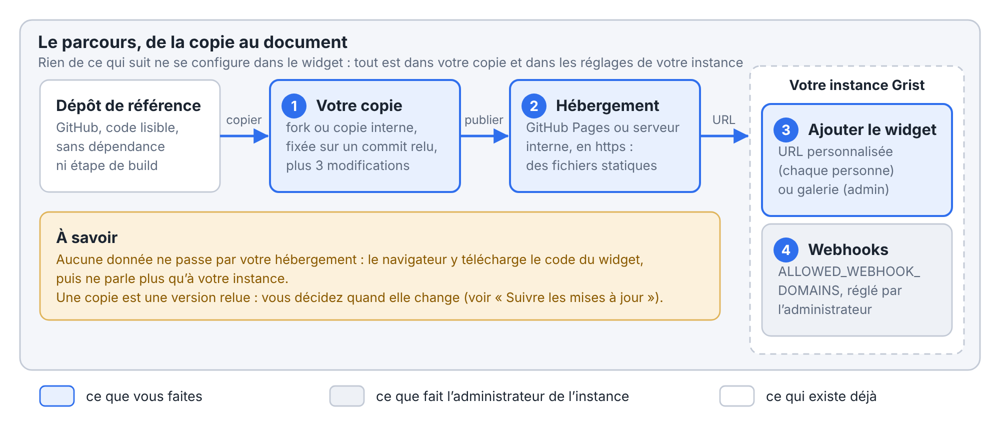
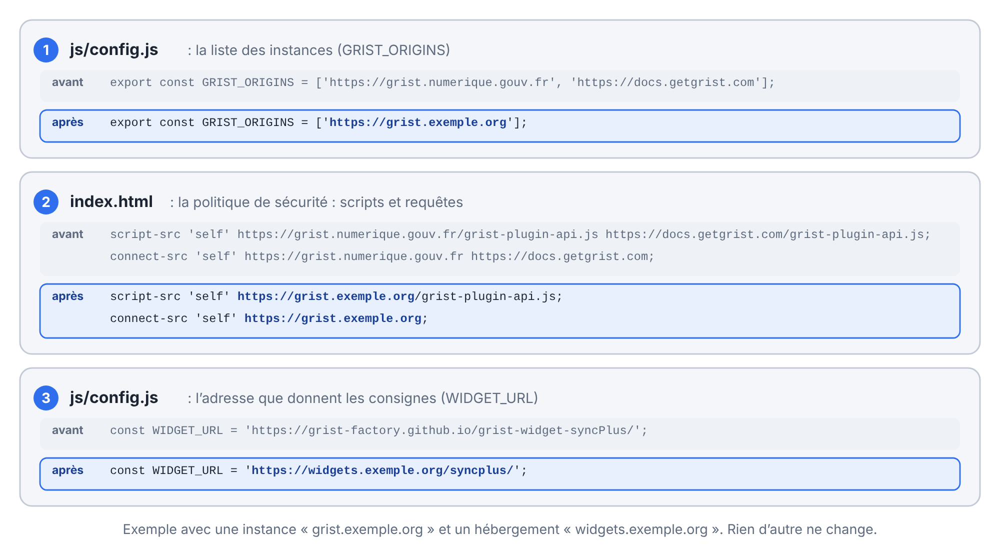
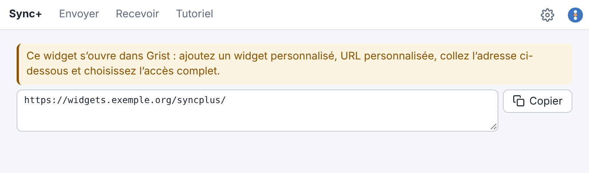
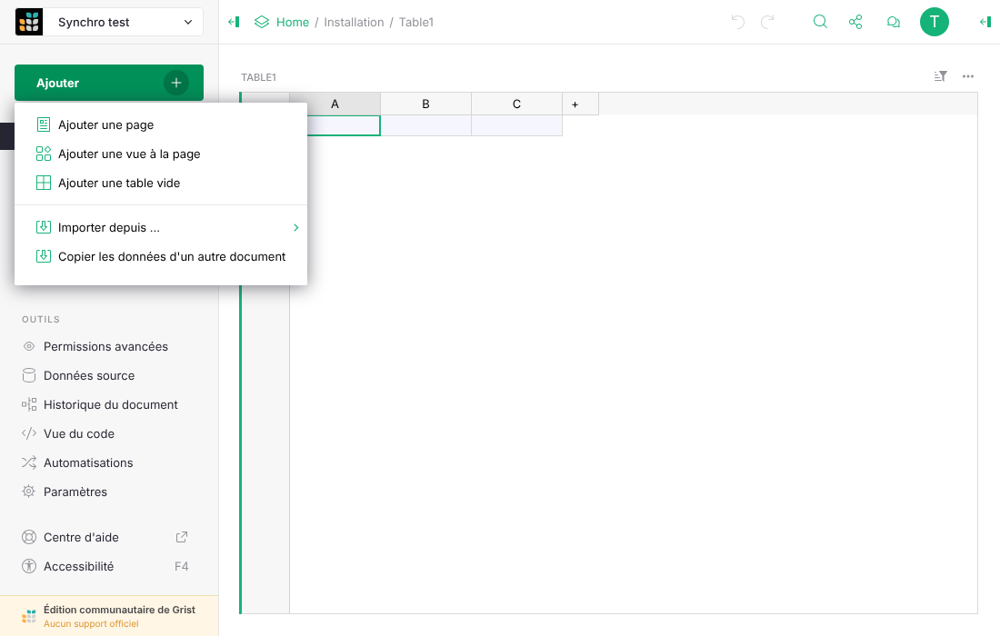
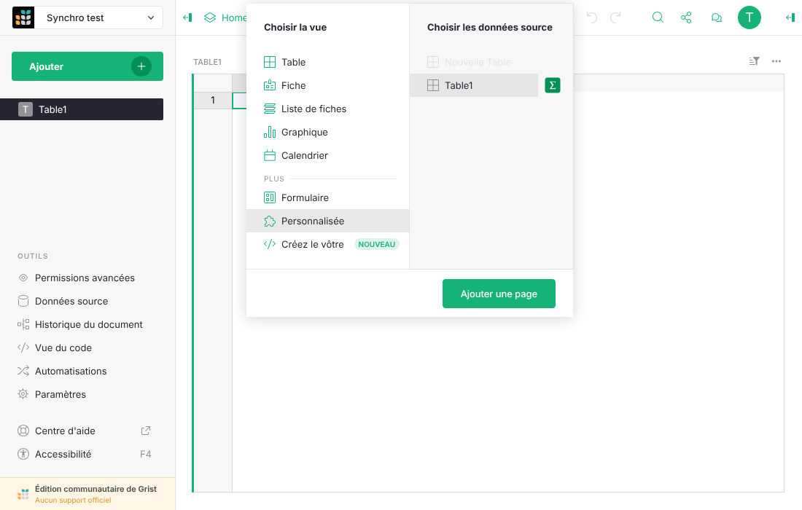
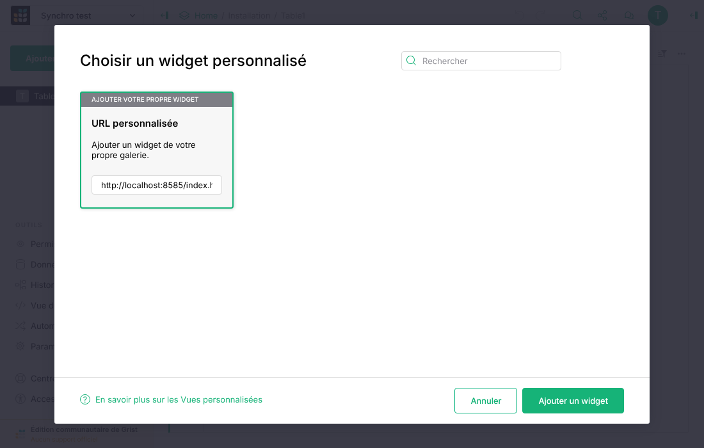
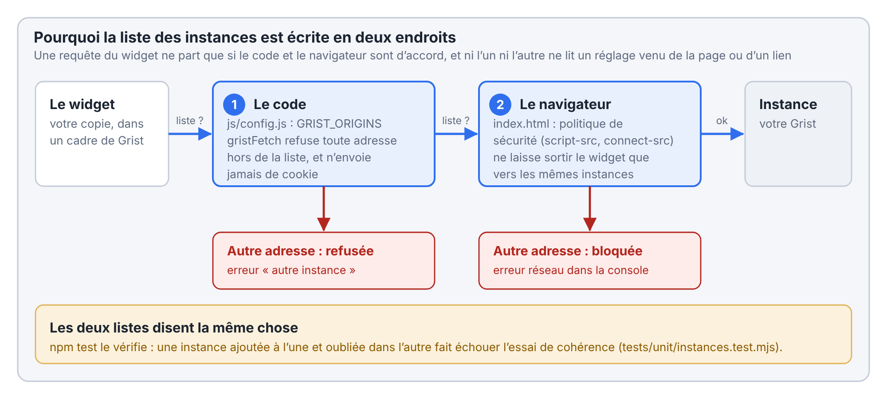
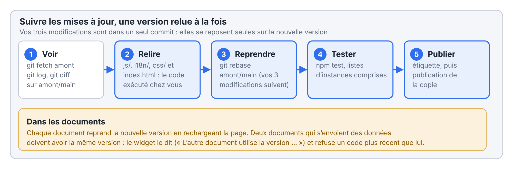
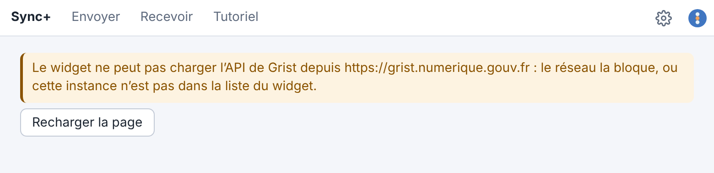

# Héberger sa propre copie du widget

*English version: [`08-self-hosting.en.md`](08-self-hosting.en.md).*

À lire si :

- votre instance Grist n'est ni `grist.numerique.gouv.fr` ni `docs.getgrist.com` (une instance
  privée, interne à votre organisation) ;
- ou si votre RSSI veut **une version figée et relue** du widget, servie depuis un serveur que
  l'organisation maîtrise, plutôt que la branche d'un dépôt public.

Dans les deux cas, la réponse est la même : **recopier le dépôt, changer trois valeurs, publier
les fichiers**. Il n'y a rien à compiler et rien à installer sur le serveur : le widget est une page
statique, sans dépendance ni étape de build.



Le guide suit ce parcours : [avant de commencer](#avant-de-commencer),
[1. copier](#1-copier-le-dépôt-et-fixer-une-version), [2. les trois modifications](#2-les-trois-modifications),
[3. vérifier](#3-vérifier-avant-de-publier), [4. héberger](#4-héberger-les-fichiers),
[5. l'ajouter dans Grist](#5-lajouter-dans-grist), [6. les webhooks de l'instance](#6-autoriser-les-webhooks-de-linstance) ;
puis [pourquoi c'est ainsi](#pourquoi-trois-modifications-à-la-main),
[suivre les mises à jour](#suivre-les-mises-à-jour) et [si quelque chose ne marche pas](#si-quelque-chose-ne-marche-pas).

## Avant de commencer

Il faut :

- **l'adresse exacte de votre instance**, par exemple `https://grist.exemple.org` : le protocole,
  le nom de domaine et, s'il y en a un, le port (`https://grist.intranet:8484`). Rien d'autre :
  ni barre finale, ni `/o/<équipe>` (l'équipe n'est pas dans l'origine d'un site) ;
- **un endroit où publier des fichiers statiques en https** : GitHub Pages, ou un serveur web
  interne (nginx, Apache, un stockage d'objets avec site statique…). Il doit être joignable depuis
  le **navigateur** des personnes qui utilisent Grist ; le serveur Grist, lui, n'a pas besoin de le
  joindre (sauf pour la galerie, à l'étape 5) ;
- Git, et Node 20 ou plus récent pour lancer les essais (conseillé : un seul essai, `npm test`,
  vérifie que vos modifications sont cohérentes) ;
- une instance **Grist 1.7.11 ou plus récent** (le widget le vérifie au branchement) ;
- un administrateur de l'instance, pour l'étape 6 et, si vous le voulez, la galerie.

## 1. Copier le dépôt et fixer une version

Un *fork* sur GitHub (bouton **Fork**) ou un clone poussé sur le dépôt interne de l'organisation :
les deux conviennent.

```bash
git clone https://github.com/lombre33/grist-widget-one-way-sync.git syncplus
cd syncplus
git remote rename origin amont        # le dépôt d'origine s'appelle « amont »
git checkout -b interne <commit>      # le commit que vous avez relu
```

Le dépôt n'a pas d'étiquettes de version : partez de l'**identifiant d'un commit** (le numéro de
version est dans `js/config.js`, `VERSION`, et dans le titre des README). Relisez-le avant de le
publier : environ 15 700 lignes de JavaScript commenté, aucune bibliothèque, aucun `innerHTML` ni
`eval` ; [`SECURITY.md`](../SECURITY.md) en donne l'analyse, avec les points qu'un RSSI regarde.

## 2. Les trois modifications

Trois valeurs, dans deux fichiers. Aucune autre ne change.



**1. `js/config.js`, `GRIST_ORIGINS`** : la liste des instances Grist avec lesquelles le widget
accepte de parler. Mettez-y la vôtre, et **retirez celles que vous n'utilisez pas** : chaque adresse
en moins est une porte de moins à relire. Si l'instance qui affiche le widget est dans la liste, le
widget charge l'API des widgets depuis elle ; sinon, depuis la **première** de la liste : mettez
donc votre instance principale en premier.

```js
export const GRIST_ORIGINS = ['https://grist.exemple.org'];
```

**2. `index.html`, la balise `Content-Security-Policy`** : la politique de sécurité que le
navigateur applique à la page. Deux directives citent les instances, à l'identique de la liste
précédente :

- `script-src` : l'adresse de l'API des widgets de chaque instance, c'est-à-dire **l'origine suivie
  de `/grist-plugin-api.js`** ;
- `connect-src` : l'**origine** seule, pour les requêtes du widget vers Grist.

```html
script-src 'self' https://grist.exemple.org/grist-plugin-api.js;
connect-src 'self' https://grist.exemple.org;
```

Avec plusieurs instances, séparez les adresses par une espace dans chaque directive. Ne touchez à
aucune autre directive (`default-src 'none'`, `style-src`, `img-src`…) : elles ferment tout le
reste.

**3. `js/config.js`, `WIDGET_URL`** : l'adresse de **votre copie**, celle que vous publierez à
l'étape 4. C'est elle que le widget donne dans ses consignes et dans l'écran « Ce widget s'ouvre
dans Grist » ; sans ce changement, il continuerait à recommander l'adresse officielle.

```js
const WIDGET_URL = 'https://widgets.exemple.org/syncplus/';
```

Elle commence par `https://` et **finit par une barre**. La constante voisine, `BETA_URL`, est
l'adresse de la version de test : laissez-la, elle ne sert que si votre copie est servie depuis
cette adresse-là.

**Faites ces trois modifications dans un seul commit**, avec un message qui le dit (« Instance
interne : liste des instances et adresse de la copie ») : c'est ce qui permet, aux mises à jour, de
les reposer d'un coup (voir [suivre les mises à jour](#suivre-les-mises-à-jour)).

## 3. Vérifier avant de publier

```bash
npm test
```

Les essais sont écrits pour Node seul, sans aucune installation. Celui qui nous intéresse ici,
`tests/unit/instances.test.mjs`, lit `GRIST_ORIGINS`, la balise de sécurité et `WIDGET_URL`, et
échoue si :

- une instance est dans la liste du code mais pas dans `script-src` ou `connect-src` (ou
  l'inverse) ;
- une adresse n'est pas une origine propre (chemin, barre finale, `http` hors `localhost`) ;
- la politique ouvre autre chose que ces instances vers l'extérieur ;
- `WIDGET_URL` n'est pas une adresse https qui finit par une barre.

Sans Node, relisez à l'œil les deux fichiers : `grep -n "GRIST_ORIGINS =\|WIDGET_URL =" js/config.js`
et `grep -o 'Content-Security-Policy.*' index.html`. Les trois valeurs doivent dire la même chose
que la figure ci-dessus.

## 4. Héberger les fichiers

Il faut publier, **à la même place les uns par rapport aux autres** :

| Fichier ou dossier | Rôle |
|---|---|
| `index.html` | la page |
| `css/`, `js/` | styles et code |
| `i18n/` | les textes, français et anglais |
| `img/` | le logo et deux images d'aide |
| `docs/images/` | les captures de l'onglet **Tutoriel** (le reste de `docs/` ne sert pas) |

Le plus simple est de tout publier tel quel (c'est ce que fait GitHub Pages). Le reste du dépôt
(`tests/`, `docs/*.md`, `README*`…) peut rester en ligne ou non : le widget n'y touche pas.

**GitHub Pages** (sur votre fork) : *Settings*, *Pages*, *Deploy from a branch*, la branche
`interne` (ou `main`), dossier `/ (root)`. L'adresse est de la forme
`https://<compte>.github.io/<dépôt>/`. Attention : un site GitHub Pages est public (sauf offre
Enterprise Cloud) ; il ne contient que du code, jamais de donnée, mais le code d'un fork peut
être lu par tout le monde.

**Serveur interne** : copiez ces fichiers dans le dossier servi. Exemple nginx :

```nginx
server {
  listen 443 ssl;
  server_name widgets.exemple.org;

  location /syncplus/ {
    alias /srv/widgets/syncplus/;      # index.html, css/, js/, i18n/, img/, docs/images/
    add_header Cache-Control "no-cache";
    # Ne pas ajouter X-Frame-Options ni « frame-ancestors » : Grist affiche le widget dans un cadre.
  }
}
```

Ce que le serveur doit respecter, quel qu'il soit :

- **https**, avec un certificat que les navigateurs des personnes acceptent ;
- les **bons types de fichier** : `.js` en `text/javascript` (ou `application/javascript`) et
  `.json` en `application/json` : le navigateur refuse un module JavaScript ou JSON servi autrement.
  Les serveurs courants le font déjà ;
- **autoriser l'affichage dans un cadre** : pas d'en-tête `X-Frame-Options: DENY` ni `SAMEORIGIN`,
  pas de `Content-Security-Policy: frame-ancestors` qui exclue votre Grist (si votre politique
  générale en pose un, ajoutez `frame-ancestors https://grist.exemple.org` pour ce dossier) ;
- **pas d'identification préalable** : le cadre d'un widget ne transmet pas vos cookies de session,
  un site derrière une authentification unique ne s'y affichera pas ;
- un cache court, ou `no-cache` : une mise à jour doit être vue au rechargement de la page.

Aucune donnée ne passe par ce serveur : il ne voit que des demandes de fichiers statiques. Le
widget parle à votre instance Grist, et seulement à elle.

**Vérification** : ouvrez l'adresse de votre copie directement dans un onglet. Le widget dit qu'il
« s'ouvre dans Grist » et affiche **l'adresse de votre copie** (la valeur de `WIDGET_URL`) : les
fichiers sont servis et la troisième modification est en place.



## 5. L'ajouter dans Grist

Le widget se pose comme n'importe quel widget personnalisé. Il y a deux voies, qui se combinent.

### Par l'adresse (chaque personne, sans administrateur)

Dans chaque document : **Ajouter**, **Ajouter une page**, vue **Personnalisée**, puis **URL
personnalisée** : coller l'adresse de votre copie, et **Ajouter un widget**.





Le widget a ensuite besoin de l'**accès complet** au document : cliquer **Accepter** dans le panneau
de droite de Grist, section **Niveau d'accès**. Les captures de cette étape, et la raison de cet
accès, sont dans le [tutoriel](04-tutoriel.md#0-installer-le-widget-dans-chaque-document).

### Par la galerie de l'instance (administrateur)

Pour que les personnes choisissent **Sync+** dans la liste des widgets, l'administrateur publie une
liste de widgets et la déclare dans le réglage `GRIST_WIDGET_LIST_URL` de l'instance. C'est un
fichier JSON : un tableau de widgets, que Grist lit **depuis le serveur**. L'adresse du widget
peut y être relative à celle du fichier.

```json
[
  {
    "name": "Sync+",
    "widgetId": "syncplus",
    "url": "https://widgets.exemple.org/syncplus/",
    "accessLevel": "full",
    "renderAfterReady": false,
    "published": true,
    "description": "Synchroniser une table d'un document Grist vers un autre, dans un seul sens ou dans les deux.",
    "authors": [{ "name": "Organisation" }]
  }
]
```

Deux précisions, relues dans le code de Grist (1.7) :

- ce réglage **remplace** la liste par défaut (celle de Grist Labs) : si l'instance garde sa
  galerie habituelle, le fichier doit reprendre aussi ses entrées. L'administrateur sait faire ;
- une entrée « accès complet » ne donne rien d'office : Grist demande quand même à la personne
  d'accepter, comme pour une adresse saisie à la main.

Le widget porte le nom « Sync+ » à l'écran : gardez-le dans la galerie, c'est celui que citent le
tutoriel et les consignes du widget.

## 6. Autoriser les webhooks de l'instance

Le widget envoie les données **par des webhooks natifs de Grist** : c'est le serveur Grist de la
SOURCE qui écrit dans le document CIBLE, même quand personne n'a de page ouverte. Grist ne crée un
webhook que vers une adresse de la liste **`ALLOWED_WEBHOOK_DOMAINS`** de l'instance, et refuse
sinon. Cette liste est un réglage de l'administrateur, pas du widget.

Il faut donc que cette liste contienne **l'instance elle-même** :

```
ALLOWED_WEBHOOK_DOMAINS=grist.exemple.org
```

Si elle est vide, ou n'a pas votre instance, le widget le dit à l'étape « Approuver et brancher » :
« cette instance n'autorise pas les webhooks vers sa propre adresse », et **rien n'est branché**.
Demandez alors à l'administrateur d'ajouter l'adresse de l'instance (le nom de domaine suffit ; les
sous-domaines sont couverts). Le caractère `*` autorise tout : à éviter, il ôte la barrière qui
empêche une copie piégée d'un widget d'envoyer des données ailleurs (voir
[`SECURITY.md`](../SECURITY.md#chaîne-dapprovisionnement)).

Sur `grist.numerique.gouv.fr`, rien à demander : les webhooks y sont déjà limités à l'instance.

## Pourquoi trois modifications à la main ?

On pourrait imaginer un réglage dans l'interface, ou une adresse passée dans l'URL du widget. C'est
écarté exprès, parce que le widget a un **accès complet** au document : ce qui décide à quel
serveur il parle ne doit pas pouvoir être changé par un lien, une page qui l'encadre ou une
saisie.



- **La liste est dans le code relu.** Un RSSI lit une ligne de `js/config.js`, une balise de
  `index.html` et sait avec qui le widget parle. Aucun fichier de configuration, aucun paramètre
  d'adresse, aucune variable d'environnement n'y change quoi que ce soit.
- **Deux verrous.** Le code (`gristFetch`) refuse toute adresse hors de la liste et n'envoie jamais
  de cookie ; le navigateur (la politique de sécurité) ne laisse sortir la page que vers les mêmes
  instances. Il faut que les deux soient d'accord : d'où l'essai de cohérence de l'étape 3.
- **L'API des widgets vient de l'instance de la liste qui affiche le widget**, jamais d'une adresse
  choisie par la page qui l'encadre.
- **Une copie figée est une version relue.** Vous décidez quand elle change, et ce que vous
  publiez est exactement ce que vous avez lu.

## Suivre les mises à jour

Le dépôt d'origine évolue ; votre copie, non, tant que vous ne la changez pas. Pour reprendre une
nouvelle version :



```bash
git fetch amont
git log --oneline interne..amont/main     # ce qui a changé
git diff interne amont/main -- js i18n css index.html    # le code qui s'exécutera chez vous
git rebase amont/main                      # vos trois modifications se reposent sur la nouvelle version
npm test
```

1. **Voir** ce qui a changé, et **relire** le code qui s'exécutera : `js/`, `i18n/`, `css/` et
   `index.html` (le reste est de la documentation et des essais) ;
2. **reprendre** : `git rebase` repose votre commit des trois modifications sur la nouvelle version.
   Il n'y a de conflit que si le dépôt d'origine a changé ces mêmes lignes (par exemple la
   politique de sécurité, ou une instance de plus dans la liste) : gardez alors le texte d'origine et
   refaites vos trois modifications ;
3. **tester**, avec `npm test` (l'essai de cohérence compris) ;
4. **publier** : poussez, ou copiez les fichiers sur le serveur, et notez la version publiée
   (un commit, ou une étiquette que vous créez : le dépôt d'origine n'en a pas).

Dans les documents, chaque personne reprend la nouvelle version **en rechargeant la page** : rien
à refaire dans Grist. Deux documents qui s'envoient des données doivent utiliser **la même version**
du widget, de préférence à **la même adresse** : le widget le dit (« L'autre document utilise la
version … ») et refuse un code venu d'une version plus récente que la sienne. Mettez donc à jour
les deux côtés ensemble.

## Si quelque chose ne marche pas

Le cas le plus fréquent : une instance oubliée dans la liste. Le widget le dit ainsi :



| Ce qu'on voit | Cause probable | À faire |
|---|---|---|
| « Le widget ne peut pas charger l'API de Grist depuis https://… » (le nom est celui d'une instance de la liste) | L'instance qui affiche le widget n'est pas dans `GRIST_ORIGINS` (le widget retombe sur la première), ou le réseau bloque `<instance>/grist-plugin-api.js` | Comparer cette adresse à celle de votre instance : si elle diffère, modification 1 manquante ; sinon, un pare-feu ou un mandataire |
| Le même écran, et dans la console du navigateur « Refused to load the script… Content Security Policy » | `script-src` ne contient pas votre instance | Modification 2 (`index.html`) |
| Le widget démarre mais les requêtes échouent, console « Refused to connect… » ou l'erreur « Le document CIBLE est sur une autre instance Grist » | `connect-src` ou `GRIST_ORIGINS` ne contient pas l'instance | Modifications 1 et 2, `npm test` |
| Ouverte seule, la copie affiche l'adresse officielle (`grist-factory.github.io…`) | `WIDGET_URL` n'a pas été changée | Modification 3 |
| Un cadre vide ou « refused to connect » dans Grist | Le serveur interdit l'affichage dans un cadre | Retirer `X-Frame-Options` ou autoriser votre instance dans `frame-ancestors` |
| Console : « Failed to load module script… MIME type » | Le serveur sert les `.js` ou `.json` avec un mauvais type | Corriger les types de fichier du serveur |
| Un cadre vide sur un site derrière une authentification | Le cadre n'envoie pas vos cookies | Publier ce dossier sans authentification (il ne contient pas de donnée) |
| « Cette instance n'autorise pas les webhooks vers sa propre adresse » au branchement | `ALLOWED_WEBHOOK_DOMAINS` n'a pas l'instance | [Étape 6](#6-autoriser-les-webhooks-de-linstance) |
| Sync+ n'apparaît pas dans la galerie | `GRIST_WIDGET_LIST_URL` n'est pas réglé, le fichier n'est pas lisible depuis le serveur Grist, ou ce n'est pas un tableau JSON | Utiliser l'adresse personnalisée en attendant ; vérifier le fichier côté serveur |
| « L'autre document utilise la version … du widget » | Les deux documents n'ont pas la même version ou la même adresse | Mettre les deux à la même copie, rechargement compris |

La page **Réglages** du widget a un bouton de diagnostic qui copie la version, l'origine d'où le
widget est servi (« officielle », « bêta » ou l'adresse de votre copie) et le navigateur, sans
aucune donnée de table ni adresse d'écriture : utile à joindre à une demande d'aide.
