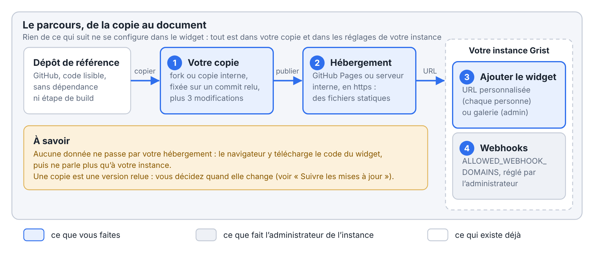
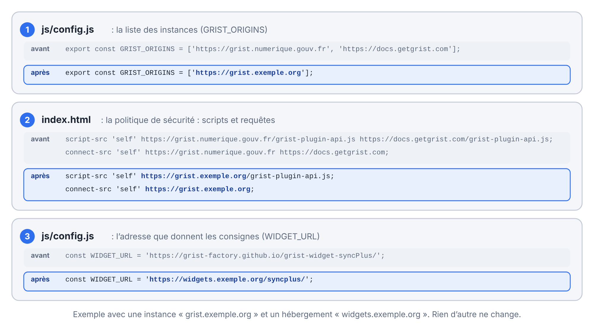
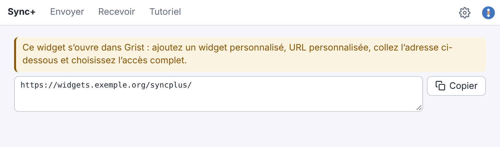
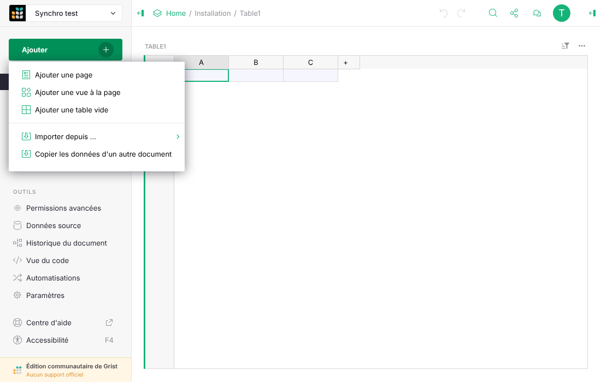
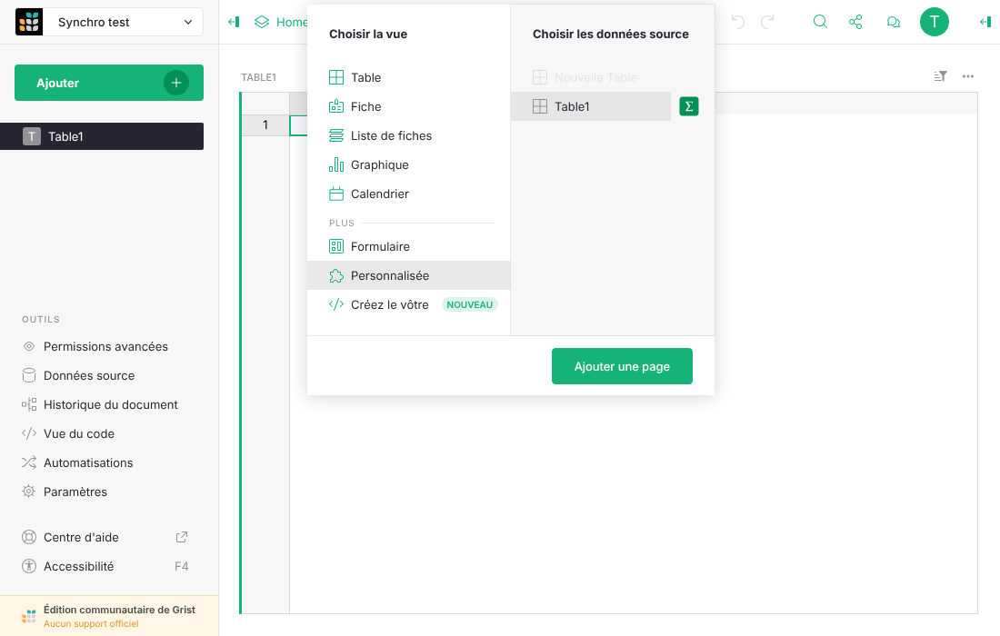
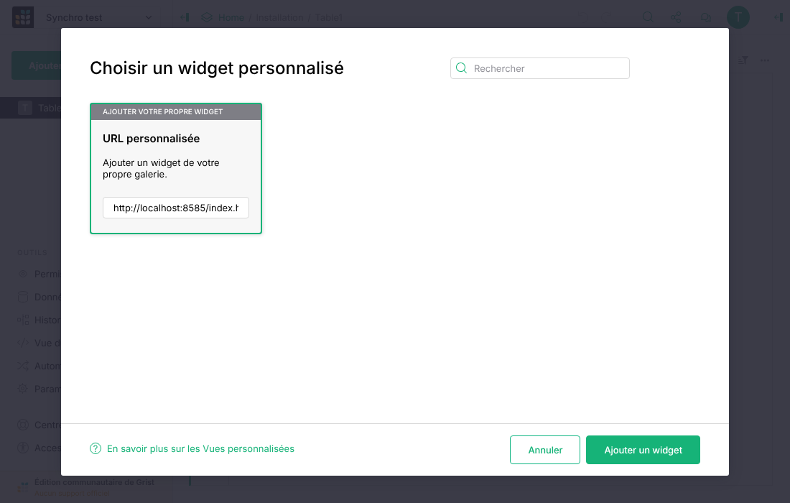
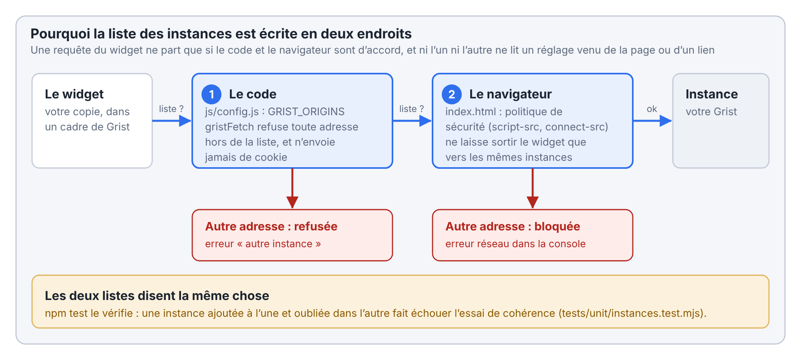
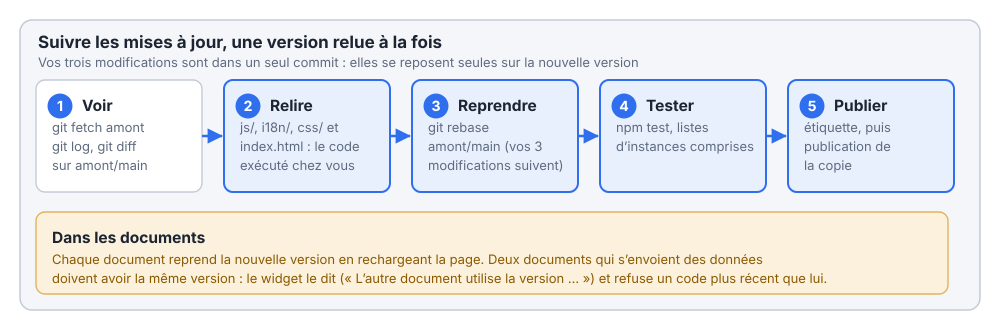
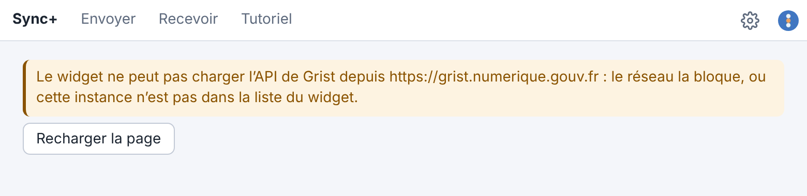

# Hosting your own copy of the widget

*Version française : [`08-auto-hebergement.md`](08-auto-hebergement.md).*

Read this if:

- your Grist instance is neither `grist.numerique.gouv.fr` nor `docs.getgrist.com` (a private
  instance, internal to your organisation);
- or your security officer wants **a frozen, reviewed version** of the widget, served from a server
  the organisation controls, rather than the branch of a public repository.

Either way the answer is the same: **copy the repository, change three values, publish the
files**. There is nothing to compile and nothing to install on the server: the widget is a static
page, with no dependency and no build step.



*(The figures are in French; the steps below say the same thing.)*

The guide follows that path: [before you start](#before-you-start),
[1. copy](#1-copy-the-repository-and-pin-a-version), [2. the three edits](#2-the-three-edits),
[3. check](#3-check-before-publishing), [4. host](#4-host-the-files),
[5. add it in Grist](#5-add-it-in-grist), [6. the instance's webhooks](#6-allow-the-instances-webhooks);
then [why it is like this](#why-three-edits-by-hand), [following updates](#following-updates) and
[when something does not work](#when-something-does-not-work).

## Before you start

You need:

- **the exact address of your instance**, for example `https://grist.example.org`: the protocol,
  the domain name and, if there is one, the port (`https://grist.internal:8484`). Nothing else: no
  trailing slash, no `/o/<team>` (the team is not part of a site's origin);
- **somewhere to publish static files over https**: GitHub Pages, or an internal web server (nginx,
  Apache, object storage with a static site…). It must be reachable from the **browser** of the
  people who use Grist; the Grist server itself does not need to reach it (except for the gallery,
  in step 5);
- Git, and Node 20 or newer to run the tests (advised: one test, `npm test`, checks that your edits
  are consistent);
- a **Grist 1.7.11 or newer** instance (the widget checks it when connecting);
- an administrator of the instance, for step 6 and, if you want it, the gallery.

## 1. Copy the repository and pin a version

A GitHub *fork* (the **Fork** button) or a clone pushed to the organisation's internal repository:
both work.

```bash
git clone https://github.com/lombre33/grist-widget-one-way-sync.git syncplus
cd syncplus
git remote rename origin upstream     # the original repository is called « upstream »
git checkout -b internal <commit>     # the commit you have reviewed
```

The repository has no version tags: start from a **commit id** (the version number is in
`js/config.js`, `VERSION`, and in the README title). Review it before publishing: about 15,700 lines
of commented JavaScript, no library, no `innerHTML` and no `eval`; [`SECURITY.md`](../SECURITY.md)
gives the analysis (in French), with the points a security officer looks at.

## 2. The three edits

Three values, in two files. Nothing else changes.



**1. `js/config.js`, `GRIST_ORIGINS`**: the list of Grist instances the widget agrees to talk to.
Put yours in it, and **remove those you do not use**: every address less is one less door to
review. If the instance that displays the widget is in the list, the widget loads the widgets API
from it; otherwise from the **first** one in the list: so put your main instance first.

```js
export const GRIST_ORIGINS = ['https://grist.example.org'];
```

**2. `index.html`, the `Content-Security-Policy` tag**: the security policy the browser applies to
the page. Two directives name the instances, identically to the previous list:

- `script-src`: the widgets API address of each instance, that is **the origin followed by
  `/grist-plugin-api.js`**;
- `connect-src`: the **origin** alone, for the widget's requests to Grist.

```html
script-src 'self' https://grist.example.org/grist-plugin-api.js;
connect-src 'self' https://grist.example.org;
```

With several instances, separate the addresses with a space in each directive. Do not touch any
other directive (`default-src 'none'`, `style-src`, `img-src`…): they shut everything else.

**3. `js/config.js`, `WIDGET_URL`**: the address of **your copy**, the one you will publish in step
4. This is what the widget gives in its instructions and on its « This widget opens inside Grist »
screen; without this edit it would keep recommending the official address.

```js
const WIDGET_URL = 'https://widgets.example.org/syncplus/';
```

It starts with `https://` and **ends with a slash**. The neighbouring constant, `BETA_URL`, is the
address of the test version: leave it, it only matters if your copy is served from that very address.

**Make these three edits in a single commit**, with a message that says so (« Internal instance:
instance list and copy address »): this is what lets you re-apply them all at once on updates (see
[following updates](#following-updates)).

## 3. Check before publishing

```bash
npm test
```

The tests are written for Node alone, with no installation. The one that matters here,
`tests/unit/instances.test.mjs`, reads `GRIST_ORIGINS`, the security tag and `WIDGET_URL`, and
fails if:

- an instance is in the code's list but not in `script-src` or `connect-src` (or the other way
  round);
- an address is not a clean origin (path, trailing slash, `http` other than `localhost`);
- the policy opens anything else to the outside than these instances;
- `WIDGET_URL` is not an https address ending with a slash.

Without Node, check the two files by eye: `grep -n "GRIST_ORIGINS =\|WIDGET_URL =" js/config.js` and
`grep -o 'Content-Security-Policy.*' index.html`. The three values must say the same as the figure
above.

## 4. Host the files

Publish, **in the same places relative to each other**:

| File or folder | What it is |
|---|---|
| `index.html` | the page |
| `css/`, `js/` | styles and code |
| `i18n/` | the texts, French and English |
| `img/` | the logo and two help images |
| `docs/images/` | the screenshots of the **Tutorial** tab (the rest of `docs/` is not used) |

The simplest is to publish everything as is (this is what GitHub Pages does). The rest of the
repository (`tests/`, `docs/*.md`, `README*`…) can stay online or not: the widget never touches it.

**GitHub Pages** (on your fork): *Settings*, *Pages*, *Deploy from a branch*, the `internal` (or
`main`) branch, folder `/ (root)`. The address looks like `https://<account>.github.io/<repository>/`.
Mind that a GitHub Pages site is public (except with Enterprise Cloud); it only holds code, never
data, but a fork's code can be read by anyone.

**Internal server**: copy these files into the served folder. nginx example:

```nginx
server {
  listen 443 ssl;
  server_name widgets.example.org;

  location /syncplus/ {
    alias /srv/widgets/syncplus/;      # index.html, css/, js/, i18n/, img/, docs/images/
    add_header Cache-Control "no-cache";
    # Do not add X-Frame-Options or « frame-ancestors »: Grist shows the widget in a frame.
  }
}
```

What the server must respect, whichever it is:

- **https**, with a certificate the people's browsers accept;
- the **right file types**: `.js` as `text/javascript` (or `application/javascript`) and `.json` as
  `application/json`: the browser refuses a JavaScript or JSON module served otherwise. Common
  servers already do it;
- **allow display in a frame**: no `X-Frame-Options: DENY` or `SAMEORIGIN` header, no
  `Content-Security-Policy: frame-ancestors` that excludes your Grist (if your general policy sets
  one, add `frame-ancestors https://grist.example.org` for this folder);
- **no prior sign-in**: a widget's frame does not forward your session cookies, a site behind
  single sign-on will not display in it;
- a short cache, or `no-cache`: an update must be seen when the page is reloaded.

No data goes through this server: it only sees requests for static files. The widget talks to your
Grist instance, and only to it.

**Check**: open your copy's address directly in a tab. The widget says it « opens inside Grist » and
shows **your copy's address** (the value of `WIDGET_URL`): the files are served and the third edit is
in place.



## 5. Add it in Grist

The widget is added like any custom widget. There are two ways, and they combine.

### By address (each person, no administrator)

In each document: **Add**, **Add Page**, **Custom** view, then **Custom URL**: paste your copy's
address, and **Add Widget**.





The widget then needs **full access** to the document: click **Accept** in Grist's right panel,
under **Access level**. The screenshots of this step, and the reason for this access, are in the
[tutorial](04-tutoriel.md#0-installer-le-widget-dans-chaque-document) (in French).

### Through the instance's gallery (administrator)

For people to pick **Sync+** in the list of widgets, the administrator publishes a widget list and
declares it in the instance's `GRIST_WIDGET_LIST_URL` setting. It is a JSON file: an array of
widgets, which Grist reads **from the server**. The widget's address may be relative to the file's.

```json
[
  {
    "name": "Sync+",
    "widgetId": "syncplus",
    "url": "https://widgets.example.org/syncplus/",
    "accessLevel": "full",
    "renderAfterReady": false,
    "published": true,
    "description": "Synchronise a table from one Grist document to another, one way or both ways.",
    "authors": [{ "name": "Organisation" }]
  }
]
```

Two clarifications, read in Grist's code (1.7):

- this setting **replaces** the default list (Grist Labs'): if the instance keeps its usual
  gallery, the file must also include its entries. The administrator knows how;
- a « full access » entry grants nothing by itself: Grist still asks the person to accept, as for
  an address typed by hand.

The widget is named « Sync+ » on screen: keep it in the gallery, it is the name the tutorial and
the widget's instructions quote.

## 6. Allow the instance's webhooks

The widget sends data **through Grist's native webhooks**: it is the SOURCE's Grist server that
writes into the TARGET document, even when nobody has a page open. Grist only creates a webhook to
an address in the instance's **`ALLOWED_WEBHOOK_DOMAINS`** list, and refuses otherwise. That list is
an administrator's setting, not the widget's.

So the list must contain **the instance itself**:

```
ALLOWED_WEBHOOK_DOMAINS=grist.example.org
```

If it is empty, or lacks your instance, the widget says so at the « Approve and connect » step:
« this instance does not allow webhooks to its own address », and **nothing is connected**. Ask the
administrator to add the instance's address (the domain name is enough; subdomains are covered).
The `*` character allows everything: avoid it, it removes the barrier that stops a booby-trapped
copy of a widget from sending data elsewhere (see
[`SECURITY.md`](../SECURITY.md#chaîne-dapprovisionnement), in French).

On `grist.numerique.gouv.fr` there is nothing to ask: webhooks are already limited to the instance.

## Why three edits by hand?

One could imagine a setting in the interface, or an address passed in the widget's URL. It is
ruled out on purpose, because the widget has **full access** to the document: what decides which
server it talks to must not be changeable by a link, by a page framing it, or by typing.



- **The list is in the reviewed code.** A security officer reads one line of `js/config.js`, one
  tag of `index.html`, and knows who the widget talks to. No configuration file, no address
  parameter, no environment variable changes anything about it.
- **Two locks.** The code (`gristFetch`) refuses any address outside the list and never sends a
  cookie; the browser (the security policy) only lets the page reach the same instances. Both must
  agree: hence the consistency test of step 3.
- **The widgets API comes from the instance in the list that displays the widget**, never from an
  address chosen by the page framing it.
- **A frozen copy is a reviewed version.** You decide when it changes, and what you publish is
  exactly what you have read.

## Following updates

The original repository moves on; your copy does not, until you change it. To take a new version:



```bash
git fetch upstream
git log --oneline internal..upstream/main     # what changed
git diff internal upstream/main -- js i18n css index.html    # the code that will run at your place
git rebase upstream/main                       # your three edits are re-applied on the new version
npm test
```

1. **See** what changed, and **review** the code that will run: `js/`, `i18n/`, `css/` and
   `index.html` (the rest is documentation and tests);
2. **take it**: `git rebase` re-applies your three-edit commit on the new version. There is a
   conflict only if the original repository changed those very lines (for example the security
   policy, or one more instance in the list): then keep the original text and redo your three edits;
3. **test**, with `npm test` (the consistency test included);
4. **publish**: push, or copy the files to the server, and note the published version (a commit,
   or a tag you create: the original repository has none).

In the documents, each person takes the new version **by reloading the page**: nothing to redo in
Grist. Two documents that send each other data must use **the same version** of the widget,
preferably at **the same address**: the widget says so (« The other document uses version … ») and
refuses a code coming from a version newer than its own. So update both sides together.

## When something does not work

The most frequent case: an instance forgotten in the list. The widget says it like this (here in French):



| What you see | Likely cause | What to do |
|---|---|---|
| « The widget cannot load the Grist API from https://… » (the name is that of an instance in the list) | The instance displaying the widget is not in `GRIST_ORIGINS` (the widget falls back on the first), or the network blocks `<instance>/grist-plugin-api.js` | Compare that address to your instance's: if it differs, edit 1 is missing; otherwise a firewall or a proxy |
| The same screen, and in the browser console « Refused to load the script… Content Security Policy » | `script-src` does not contain your instance | Edit 2 (`index.html`) |
| The widget starts but requests fail, console « Refused to connect… » or the error « The TARGET document is on another Grist instance » | `connect-src` or `GRIST_ORIGINS` does not contain the instance | Edits 1 and 2, `npm test` |
| Opened alone, the copy shows the official address (`grist-factory.github.io…`) | `WIDGET_URL` was not changed | Edit 3 |
| An empty frame or « refused to connect » in Grist | The server forbids display in a frame | Remove `X-Frame-Options` or allow your instance in `frame-ancestors` |
| Console: « Failed to load module script… MIME type » | The server serves `.js` or `.json` with a wrong type | Fix the server's file types |
| An empty frame on a site behind a sign-in | The frame does not send your cookies | Publish this folder without authentication (it holds no data) |
| « This instance does not allow webhooks to its own address » when connecting | `ALLOWED_WEBHOOK_DOMAINS` lacks the instance | [Step 6](#6-allow-the-instances-webhooks) |
| Sync+ is not in the gallery | `GRIST_WIDGET_LIST_URL` is not set, the file cannot be read from the Grist server, or it is not a JSON array | Use the custom address meanwhile; check the file on the server side |
| « The other document uses version … of the widget » | The two documents do not have the same version or address | Put both on the same copy, page reload included |

The widget's **Settings** page has a diagnostic button that copies the version, the origin the
widget is served from (« official », « beta » or your copy's address) and the browser, with no table
data and no write address: useful to attach to a request for help.

The widget's screen texts quoted in this guide are given in English; the widget shows them in the
language of the browser or the one chosen in Settings.
